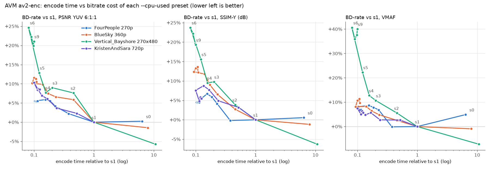
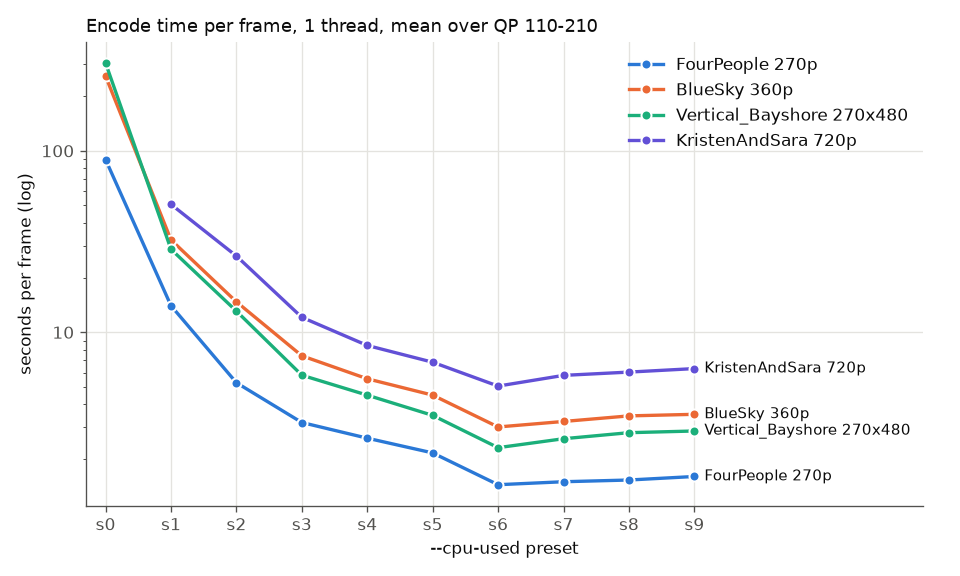
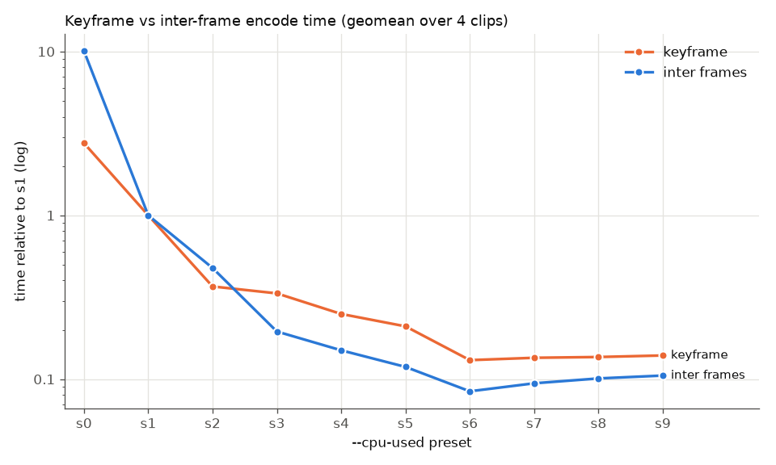

# AVM encoder presets: speed vs compression (14 Oct 2026)

How much compression do you lose with each `avmenc --cpu-used` preset, and how
much time do you save? An overnight sweep of presets 0-9 on four short clips,
scored with PSNR, SSIM and VMAF.

- **Encoder:** AVM `av2-enc` branch, commit
  [`89eae123d`](https://github.com/AOMediaCodec/avm/commit/89eae123dc671af8eba5df14781287108375ecd8)
  (`1.0.0-434-g89eae123d`), the same branch as the
  [nightly builds](https://ewouth.github.io/AV2/).
- **Machine:** Intel Core i7-12700H laptop, 32 GB, Windows 11. MSVC 19.51
  Release build.

## Findings

1. **s6 is the fastest preset.** s7, s8 and s9 are 8-25% *slower* than s6, and
   save at most 2.6% bits. The `--cpu-used` number stops tracking speed after
   6. (Some speed features in AVM's `speed_features.c` check `speed == 6` or
   `speed <= 6`. On AVM `main`, s7-s9 behave
   the same as s6.)
2. **The default, s0, is rarely worth it.** `avmenc` uses `--cpu-used=0` when
   you don't set it. s0 is 6-11x slower than s1 and saves 2.3% bits on average
   (PSNR), with a range of -5.7% to +0.2% per clip. On FourPeople, s0 is even
   worse than s1 on VMAF.
3. **s6 is about 10x faster than s1, for 10-14% more bits** (PSNR, mean). One clip,
   Vertical_Bayshore, loses much more at the fast presets: +25% (PSNR) and
   +41% (VMAF) at s6.
4. **s3 is a good middle point.** It's 4-5x faster than s1 for 4-9% more bits. On the low-res clips, s2 costs 5% bits for only 2.3x speed, almost
   the loss of s3 at twice its time.
5. **Inter frames speed up more than keyframes.** At s6, inter frames take 8%
   of their s1 time, keyframes 13%. From s2 to s3, keyframes get only 10%
   faster but inter frames 2.4x faster.
6. **It is slow.** At s6 and one thread, an encode takes 1.4-3 s per frame at
   270p/360p and 5 s per frame at 720p (mean over the 4 QPs). At 1080p it
   is 15 s per frame at QP 210, the cheapest QP (crowd_run). At s1 it is
   14-32 s per frame at low res and 51 s per frame at 720p.

## Setup

| | |
|---|---|
| Clips (8-bit 4:2:0, AV2 CTC set) | FourPeople 480x270 60 fps, BlueSky 640x360 25 fps, Vertical_Bayshore 270x480 29.97 fps (33 frames each); KristenAndSara 1280x720 60 fps (65 frames); crowd_run 1920x1080 50 fps (33 frames, incomplete) |
| Presets | `--cpu-used` 0-9 on the low-res clips, 1-9 on 720p/1080p (s0 was too slow) |
| QPs | 110, 145, 180, 210 (`--end-usage=q --qp=<QP>`) |
| Command | `avmenc <clip>.y4m -o out.ivf --ivf --limit=<frames> --end-usage=q --qp=<QP> --cpu-used=<preset> --threads=1 --psnr=1` |
| Parallelism | 6 encodes at a time, each with 1 thread and pinned to its own P-core. Quality scoring ran on the E-cores. |
| Rate | Payload bytes (frame data, without IVF headers) |
| PSNR | `avmenc` frame-mean PSNR, combined as YUV 6:1:1 |
| SSIM | SSIM-Y from ffmpeg, in dB (`-10 log10(1 - SSIM)`) |
| VMAF | libvmaf `vmaf_v0.6.1`, pooled mean, at native resolution |
| BD-rate | PCHIP in the log-rate domain over the 4 QPs. Negative = fewer bits than the reference at equal quality. |

Each stream was decoded with `avmdec` and scored against the source with
ffmpeg 2026-09-28. As an alignment check, ffmpeg's frame-mean PSNR-Y had to
match `avmenc`'s within 0.05 dB: 169 of 169 encodes passed.

The sweep started at 21:15 with a stop time of 07:00 for new encodes; the
last results came in at 08:47. 169 of the 231 planned encodes finished
(166 plus 3 repeats). One more, crowd_run QP 145 s1, was still running when
this was written and is not included. The low-res clips and KristenAndSara are complete.
crowd_run 1080p is only partly done (10 of 36 encodes), and old_town_cross
1080p never started.

## Results

### BD-rate and time vs s1

Low-res clips (mean BD-rate and geometric mean time over FourPeople, BlueSky
and Vertical_Bayshore):

| preset | time vs s1 | BD PSNR | BD SSIM | BD VMAF |
|---|--:|--:|--:|--:|
| s0 | 8.16x | -2.3% | -2.3% | -1.1% |
| s1 | 1.00x | 0% | 0% | 0% |
| s2 | 0.43x | +5.2% | +2.1% | +2.7% |
| s3 | 0.22x | +6.6% | +6.8% | +7.4% |
| s4 | 0.17x | +6.9% | +8.1% | +9.0% |
| s5 | 0.14x | +9.5% | +11.4% | +13.1% |
| s6 | 0.09x | +13.5% | +13.5% | +19.0% |
| s7 | 0.10x | +13.1% | +13.3% | +17.9% |
| s8 | 0.10x | +12.2% | +12.6% | +18.7% |
| s9 | 0.11x | +12.4% | +12.0% | +18.9% |

KristenAndSara 720p (65 frames):

| preset | time vs s1 | BD PSNR | BD SSIM | BD VMAF |
|---|--:|--:|--:|--:|
| s1 | 1.00x | 0% | 0% | 0% |
| s2 | 0.52x | +2.3% | +3.2% | +2.7% |
| s3 | 0.24x | +3.7% | +4.9% | +2.7% |
| s4 | 0.17x | +6.1% | +7.7% | +5.7% |
| s5 | 0.13x | +6.9% | +8.8% | +4.8% |
| s6 | 0.10x | +10.3% | +7.6% | +7.5% |
| s7 | 0.11x | +8.4% | +4.9% | +5.0% |
| s8 | 0.12x | +8.7% | +5.8% | +6.3% |
| s9 | 0.12x | +8.5% | +5.4% | +5.6% |

Per clip (BD-rate PSNR / time, both vs s1):

| preset | FourPeople 270p | BlueSky 360p | Vertical_Bayshore 270x480 | KristenAndSara 720p |
|---|--:|--:|--:|--:|
| s0 | +0.2% / 6.39x | -1.4% / 7.99x | -5.7% / 10.63x | - |
| s1 | 0% / 1.00x | 0% / 1.00x | 0% / 1.00x | 0% / 1.00x |
| s2 | +2.2% / 0.38x | +5.9% / 0.46x | +7.6% / 0.46x | +2.3% / 0.52x |
| s3 | +4.1% / 0.23x | +6.6% / 0.23x | +9.0% / 0.20x | +3.7% / 0.24x |
| s4 | +5.5% / 0.19x | +7.5% / 0.17x | +7.7% / 0.16x | +6.1% / 0.17x |
| s5 | +5.9% / 0.15x | +9.9% / 0.14x | +12.9% / 0.12x | +6.9% / 0.13x |
| s6 | +5.5% / 0.10x | +10.2% / 0.09x | +24.7% / 0.08x | +10.3% / 0.10x |
| s7 | +5.5% / 0.11x | +11.6% / 0.10x | +22.3% / 0.09x | +8.4% / 0.11x |
| s8 | +5.4% / 0.11x | +11.3% / 0.11x | +19.9% / 0.10x | +8.7% / 0.12x |
| s9 | +5.5% / 0.11x | +10.5% / 0.11x | +21.1% / 0.10x | +8.5% / 0.12x |

### Gain over s6

The same data with s6 as the reference: what do you gain by going slower
than the fastest preset?

| preset | low-res: time | BD PSNR | BD VMAF | 720p: time | BD PSNR | BD VMAF |
|---|--:|--:|--:|--:|--:|--:|
| s0 | 88.9x | -13.2% | -15.2% | | | |
| s1 | 10.9x | -11.4% | -14.7% | 10.0x | -9.3% | -6.9% |
| s2 | 4.66x | -6.7% | -12.5% | 5.21x | -7.3% | -4.4% |
| s3 | 2.39x | -5.7% | -8.2% | 2.39x | -5.9% | -4.3% |
| s4 | 1.86x | -5.3% | -7.0% | 1.67x | -3.7% | -1.6% |
| s5 | 1.50x | -3.1% | -3.7% | 1.35x | -3.0% | -2.4% |
| s6 | 1.00x | 0% | 0% | 1.00x | 0% | 0% |
| s7 | 1.08x | -0.2% | -0.4% | 1.15x | -1.8% | -2.3% |
| s8 | 1.14x | -0.9% | +0.1% | 1.19x | -1.5% | -1.0% |
| s9 | 1.17x | -0.8% | +0.1% | 1.25x | -1.6% | -1.7% |

### Encode time and memory

Seconds per frame (total time over the 4 QPs / total frames) and peak memory,
one thread:

| preset | FourPeople 270p | BlueSky 360p | Vertical_Bayshore 270x480 | KristenAndSara 720p |
|---|--:|--:|--:|--:|
| s0 | 89.5 s / 575 MB | 258 s / 635 MB | 305 s / 509 MB | - |
| s1 | 14.0 s / 450 MB | 32.3 s / 494 MB | 28.7 s / 416 MB | 50.7 s / 876 MB |
| s2 | 5.3 s / 339 MB | 14.7 s / 404 MB | 13.1 s / 342 MB | 26.3 s / 741 MB |
| s3 | 3.2 s / 338 MB | 7.4 s / 402 MB | 5.8 s / 344 MB | 12.1 s / 742 MB |
| s4 | 2.6 s / 337 MB | 5.5 s / 401 MB | 4.5 s / 344 MB | 8.5 s / 728 MB |
| s5 | 2.2 s / 336 MB | 4.5 s / 399 MB | 3.5 s / 343 MB | 6.8 s / 726 MB |
| s6 | 1.4 s / 340 MB | 3.0 s / 399 MB | 2.3 s / 343 MB | 5.1 s / 728 MB |
| s7 | 1.5 s / 339 MB | 3.2 s / 399 MB | 2.6 s / 344 MB | 5.8 s / 733 MB |
| s8 | 1.5 s / 340 MB | 3.5 s / 399 MB | 2.8 s / 344 MB | 6.0 s / 732 MB |
| s9 | 1.6 s / 340 MB | 3.5 s / 398 MB | 2.9 s / 344 MB | 6.3 s / 734 MB |

Memory hardly depends on the preset from s2 up; s0 and s1 use 100-250 MB
more. The 1080p encodes peaked at 1.2-1.3 GB.

Lower QPs (higher quality) take longer. Relative to QP 145 (geometric mean
over all complete clip/preset series): QP 110 1.63x, QP 180 0.67x, QP 210
0.47x.

### Keyframes vs inter frames

In these short encodes the single keyframe takes on average 23-33% of the
encode time at s1-s9 (14-53% per clip) and 30-63% of the bits. s0 spends most of its
extra time on inter frames: they are 10x slower than at s1, the keyframe only
2.8x.

### crowd_run 1080p (incomplete)

Too few encodes for BD-rates, but the encodes at the same QP can be compared
directly:

| QP | preset | time (s) | payload (kB) | PSNR-Y (dB) | VMAF |
|--:|---|--:|--:|--:|--:|
| 110 | s2 | 17575 | 3772 | 37.64 | 99.82 |
| 110 | s3 | 7555 | 3793 | 37.55 | 99.81 |
| 110 | s4 | 4613 | 3859 | 37.52 | 99.81 |
| 110 | s5 | 4055 | 3895 | 37.51 | 99.81 |
| 145 | s3 | 4626 | 1255 | 33.28 | 91.63 |
| 145 | s4 | 2925 | 1285 | 33.24 | 91.44 |
| 180 | s1 | 15301 | 431 | 29.31 | 71.87 |
| 210 | s1 | 7106 | 107 | 25.19 | 40.62 |
| 210 | s5 | 812 | 108 | 24.93 | 38.34 |
| 210 | s6 | 503 | 107 | 24.78 | 36.81 |

What these encodes show:

- **The speed steps between presets match 720p.** At the same QP, the time
  ratios between presets on crowd_run are close to those on KristenAndSara:

  | QP 110 | crowd_run 1080p | KristenAndSara 720p |
  |---|--:|--:|
  | s3 vs s2 | 0.43x | 0.42x |
  | s4 vs s2 | 0.26x | 0.27x |
  | s5 vs s2 | 0.23x | 0.22x |
  | s4 vs s3 | 0.61x | 0.63x |

  At QP 210 the fast presets gain more: s6 is 14x faster than s1 (about 8x on
  KristenAndSara at that QP), at the same size, for 0.4 dB PSNR-Y less.
- **Memory:** 1.2 GB at s3 and up, 1.3 GB at s1 and s2.

What they don't show: how much compression each preset costs at 1080p. No
preset has enough QPs for a BD-rate, and converting a single-QP difference
into bits at equal PSNR was unreliable when tested on KristenAndSara (+3% for
s6 vs s1, where the BD-rate is +10%). The losses look roughly in the same
range as the other clips, but that is all. crowd_run is also an extreme
clip: at QP 210 it gets 25 dB PSNR-Y and VMAF ~40, and at QP 110 VMAF is
~99.8 for every preset, so VMAF says little at either end. None of the 1080p
encodes were repeated as a timing check.

### RD curves

The curves of the presets lie close together; the BD-rate tables above give
the differences.

- [FourPeople 270p](figures/rd_FourPeople_480x270_60.png)
- [BlueSky 360p](figures/rd_BlueSky_360p25_v2.png)
- [Vertical_Bayshore 270x480](figures/rd_Vertical_Bayshore_270x480_2997.png)
- [KristenAndSara 720p](figures/rd_KristenAndSara_1280x720_60.png)

## Limits of this test

- **Short clips.** 33 or 65 frames with one keyframe, so the keyframe weighs
  heavily in both time and bits. Longer encodes would weigh the inter frames
  more, where the fast presets save the most time.
- **Few clips.** Three low-res clips and one 720p clip. The spread between
  clips is large (s6: +5.5% to +24.7% vs s1), so the means are rough.
- **Timing on a laptop.** Six encodes ran at once, on a CPU with turbo boost.
  Three encodes were repeated at the end of the low-res runs; their times were
  within 4.5% of the first run. Absolute times will differ on other machines
  and compilers; the relative times should hold better.
- **VMAF at low resolution.** The VMAF model assumes 1080p viewing. Scores on
  the 270p/360p clips are only useful to compare presets with each other.
- **One encoder version.** AVM changes quickly; these numbers are for commit
  `89eae123d` on `av2-enc`.

## Files

| File | Contents |
|---|---|
| [`sweep.jsonl`](sweep.jsonl) | Raw results, one JSON object per encode: settings, wall and CPU time, peak memory, PSNR per plane, SSIM, VMAF, and time and size per frame |
| [`results.csv`](results.csv) | The same, flattened to one row per encode (without the per-frame data) |
| [`night.log`](night.log) | Progress log of the sweep |
| [`figures/`](figures) | The charts on this page and RD curves per clip |
| [`scripts/make_report.py`](scripts/make_report.py) | Makes the figures, `results.csv` and the tables on this page from `sweep.jsonl` |
| [`scripts/sweep.py`](scripts/sweep.py), [`run_sweep.sh`](scripts/run_sweep.sh) | Ran the encodes and the quality scoring |
| [`scripts/analyze_sweep.py`](scripts/analyze_sweep.py) | First analysis during the run (Pareto charts, alignment check) |

To redo the figures and tables: `python scripts/make_report.py` (needs
numpy, scipy and matplotlib). `sweep.py` expects the local work folder of
[`samples/encode_samples.py`](../../samples/encode_samples.py) (AVM build in
`../avm_build_windows/Release/`, sources in `../sources/`) and ffmpeg with
libvmaf. It runs on Windows only (CPU pinning and process stats).
