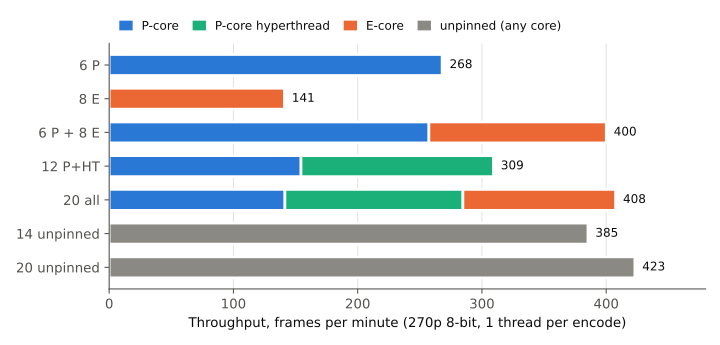
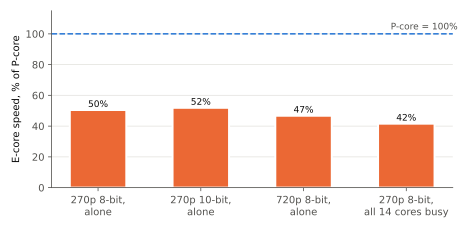

# AVM on P-cores vs E-cores: parallel encoding (15 Oct 2026)

The i7-12700H has 6 P-cores (with hyperthreading) and 8 E-cores, 20
logical CPUs in all. How fast is `avmenc` on each core type, and how should
a batch of encodes be spread over them?

- **Encoder:** AVM `av2-enc` branch, commit
  [`89eae123d`](https://github.com/AOMediaCodec/avm/commit/89eae123dc671af8eba5df14781287108375ecd8),
  the same build as the [preset sweep](../2026-10-14-avm-preset-sweep/).
- **Machine:** Intel Core i7-12700H laptop, 32 GB, Windows 11, on mains
  power. Windows power mode "Balanced" (see Limits).

## Findings

1. **An E-core is about half as fast as a P-core.** One encode on an
   otherwise idle machine takes 1.9-2.1x as long on an E-core, for 8-bit,
   10-bit and 720p input alike. With all cores busy it drops to 42%.
2. **The E-cores still add about 50% throughput.** 6 P-cores plus 8
   E-cores give 400 frames/min, against 268 for the P-cores alone. That is
   nearly the sum of the two run separately (268 + 141). The P-cores lose
   only 4% when the E-cores are busy too.
3. **E-cores slow each other down.** With all 8 busy, each E-core encode
   is 19% slower than one alone, and the E-core clock drops from about
   2.7 to 2.3 GHz.
4. **Hyperthreading is worth 15% on the P-cores alone, and almost nothing
   with the E-cores busy.** 12 encodes on the P-cores give 309 frames/min
   against 268 for 6, but each encode runs at half speed. Going from 14 to
   20 pinned encodes adds 2%, while every clock drops about 250 MHz. This
   looks like a power limit.
5. **Pinning doesn't matter much.** The four layouts that use all 14 cores
   land within 10% of each other (385-423 frames/min), and each ran once.
   Unpinned, Windows moves encodes between core types, so they all finish
   at about the same time (14 encodes: 67-74 s each). Pinned, an encode on
   an E-core takes 2.4x as long as one on a P-core.

**For batch encoding:** run 14-20 single-threaded encodes and let Windows
schedule them. If you pin instead, give the long encodes to the P-cores, so
the batch doesn't end with a 1080p encode crawling along on an E-core.

## Results

One encode, alone on an idle machine (pinned to CPU 2 or CPU 12):

| Source | P-core | E-core | E-core speed vs P-core |
|---|--:|--:|--:|
| 270p 8-bit, 33 frames | 46 s | 91 s | 50% |
| 270p 10-bit, 33 frames | 79 s | 153 s | 52% |
| 720p 8-bit, 9 frames | 90 s | 193 s | 47% |

Several encodes at once (270p 8-bit, 33 frames each):

| Layout | Slots | Total (frames/min) | vs 6 P-cores | Per slot (frames/min) | Clock P / E (MHz) |
|---|--:|--:|--:|---|---|
| 6 P | 6 | 268 | 0% | P-core 44.7 | 2730 / - |
| 8 E | 8 | 141 | -47% | E-core 17.6 | - / 2291 |
| 6 P + 8 E | 14 | 400 | +49% | P-core 42.9, E-core 17.8 | 2587 / 2298 |
| 12 P+HT | 12 | 309 | +15% | P-core 25.7, hyperthread 25.8 | 2590 / - |
| 20 all | 20 | 408 | +52% | P-core 23.6, hyperthread 23.9, E-core 15.4 | 2354 / 2025 |
| 14 unpinned | 14 | 385 | +44% | 27.5 (any core) | 2585 / 2259 |
| 20 unpinned | 20 | 423 | +58% | 21.2 (any core) | 2398 / 2057 |

## Setup

| | |
|---|---|
| Sources (AV2 CTC set) | FourPeople 480x270 8-bit and SparksElevator 480x270 10-bit (33 frames each), vidyo4 1280x720 8-bit (9 frames) |
| Command | `avmenc <clip>.y4m -o out.ivf --ivf --end-usage=q --qp=160 --cpu-used=6 --threads=1 --limit=<frames>` |
| CPUs | Logical CPUs 0-11 are the P-cores, with hyperthread pairs 0/1, 2/3 and so on; 12-19 are the E-cores. "6 P" uses CPUs 0, 2, ..., 10; "12 P+HT" uses 0-11. |
| Pinning | Each encode is pinned to one logical CPU with `psutil` (`cpu_affinity`), except in the unpinned layouts. |
| Measure | Wall time of one complete encode per slot, including its keyframe. A slot that finishes early starts filler encodes until every slot is done, so the load stays constant. Throughput = sum over slots of frames / wall time. |
| Clocks | Mean of `Processor Frequency x % Processor Performance` per logical CPU (`typeperf`, every 2 s), over the cores in use. |

`scripts/pe_bench.py` runs the test and writes `results.jsonl` (per-slot
wall and CPU time, clocks). `scripts/make_figures.py` makes the figures
and the tables above. `run.log` is the console output of the run.

## Limits

- **The P-cores never boosted.** One encode alone on a P-core ran at about
  2.6 GHz; this CPU can boost one core to about 4.7 GHz. Windows was in
  the "Balanced" power mode, and Dell's thermal profile may also cap it.
  With higher P-core clocks the P/E ratio and the best layout may change.
- Each layout ran once, with short jobs (33 frames at 270p, 9 at 720p).
  Differences under about 5% are within run-to-run noise.
- The layout tests used only 270p 8-bit. 1080p encodes need more memory
  bandwidth and cache, and may scale differently.
- A laptop's power and thermal limits shape these results. A desktop
  12th-gen CPU will behave differently.
- An earlier, shorter version of this test ran while other encodes,
  downloads and conversions were also running, and gave much lower E-core
  gains. It is not included.
