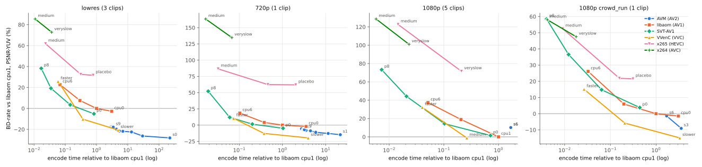
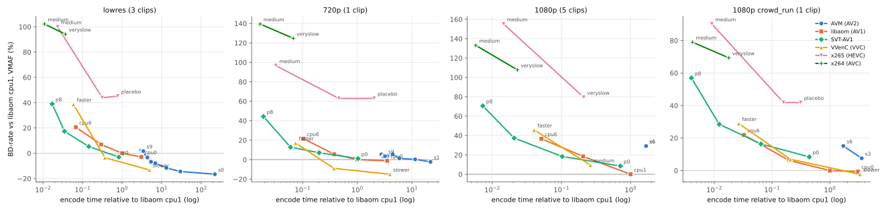
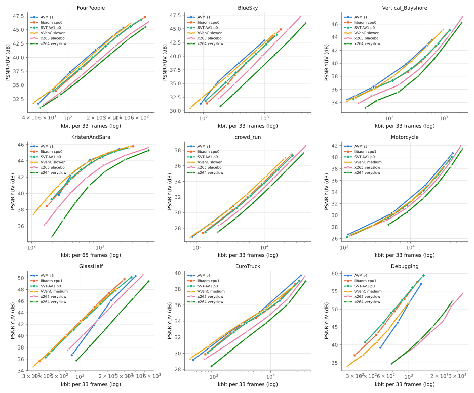

# AV2 (AVM) vs AV1, VVC, HEVC and AVC encoders (19-20 Oct 2026)

How much better is AV2 today, and at what encode time? AVM, the AV2
reference encoder, against libaom and SVT-AV1 (AV1), VVenC (VVC), x265 (HEVC)
and x264 (AVC), on the same source frames, all single-threaded on the same
machine and scored the same way.

- **AVM:** `av2-enc` [`89eae123d`](https://github.com/AOMediaCodec/avm/commit/89eae123dc671af8eba5df14781287108375ecd8),
  fixed QP 110/145/180/210 (the [preset sweep](../2026-10-14-avm-preset-sweep/)
  data, plus new 1080p encodes).
- **Others:** ffmpeg 2026-09-28 (gyan.dev full build) with libaom 3.15.1,
  SVT-AV1 4.2.0, VVenC 1.15.0-dev, x265 4.3, x264 (core 165 r3223). Each at several
  presets, 6-7 quality points spanning AVM's QP range.
- **Anchor:** libaom `--cpu-used=1`. BD-rate is the average bitrate change at
  equal quality (negative = fewer bits); time is encode time relative to the
  anchor at equal PSNR.
- **Machine:** i7-12700H, one encode per P-core, scoring on the E-cores
  ([why](../2026-10-15-avm-p-vs-e-cores/)).

## Findings

1. **On small and 720p clips, AVM is the most efficient encoder by objective
   metrics, and the slowest.** At its slow presets (s0/s1) it needs 26-28%
   fewer bits than libaom cpu-used 1 at equal PSNR on the low-res clips, and
   15% on KristenAndSara 720p, at 20-30x the encode time. AVM s6, the fastest
   preset, is still 17% (low-res) and 6% (720p) better, at 3x the time of
   libaom cpu-used 1 (about as slow as libaom cpu-used 0).
2. **VVenC slower comes close to AVM s1 at a fifth of its time.** -21% on
   the low-res clips (AVM s1: -26%) and -20% on 720p, where it beats AVM s1
   (-15%), at 4-5x the anchor's time against AVM s1's 20-30x. On SSIM and VMAF, VVenC beats AVM on 720p
   (SSIM -28% vs -14%). VVenC medium (-10 to -13%, 0.4x the time) is the
   best trade-off of all encoders tested.
3. **AVM looks much better on PSNR than on VMAF.** On the low-res clips, AVM
   s6 is -17% on PSNR but +2% on VMAF, where VVenC slower stays at -13%.
   AVM's fast presets lose most on VMAF.
4. **At 1080p, 33 frames are too few to compare AVM fairly.** On the three
   clips with motion, AVM s6 is 1-15% better than libaom cpu-used 1
   (crowd_run -1%, Motorcycle -5%, EuroTruck -15%) and AVM s3 is 9-11%
   better (crowd_run, Motorcycle). On the two static clips it is 26-46% worse
   (GlassHalf, Debugging): there 73-86% of AVM's bits go into the keyframe.
   In fixed-QP mode AVM codes the keyframe about 10 dB above the inter frames
   (GlassHalf QP 180: 50.7 dB vs 41.1 dB; libaom: 44.5 vs 42.0 dB), which
   costs bits that a 33-frame clip does not earn back.
5. **libaom cpu-used 0 is only 1-3% better than cpu-used 1, at 3x the
   time.** SVT-AV1 preset 0 is 5% better than libaom cpu-used 1 on the small
   clips at 0.8x the time, but on par at 1080p.
6. **HEVC and AVC are far behind.** x265 veryslow needs 32% (low-res) to
   72% (1080p) more bits than libaom cpu-used 1, x264 veryslow 73-135%. Part
   of this is the short, keyframe-heavy clips (AV1 and newer intra coding is
   much better); x265 placebo is not better than veryslow on the small clips.

## Results

BD-rate vs libaom `--cpu-used=1`, mean over the clips of each group; time = encode time / libaom cpu-used 1 at equal PSNR (geometric mean). Only encoders measured on every clip of a group are listed; per-clip numbers are in [results.csv](results.csv).

**lowres** (FourPeople, BlueSky, Vertical_Bayshore)

| Encoder | Clips | Time vs anchor | BD PSNR-YUV | BD SSIM-Y | BD VMAF |
|---|---:|---:|---:|---:|---:|
| AVM s0 | 3 | 222x | -28.2% | -23.6% | -16.6% |
| AVM s1 | 3 | 30x | -26.3% | -21.5% | -14.4% |
| AVM s2 | 3 | 13x | -22.5% | -19.7% | -11.6% |
| AVM s3 | 3 | 6.96x | -21.8% | -16.5% | -7.8% |
| AVM s4 | 3 | 5.40x | -21.6% | -15.5% | -6.7% |
| AVM s5 | 3 | 4.37x | -19.8% | -13.1% | -3.3% |
| AVM s6 | 3 | 3.01x | -17.2% | -11.8% | +2.2% |
| AVM s7 | 3 | 3.22x | -17.4% | -11.9% | +1.1% |
| AVM s8 | 3 | 3.36x | -18.0% | -12.4% | +1.7% |
| AVM s9 | 3 | 3.44x | -17.9% | -12.8% | +1.7% |
| libaom cpu0 | 3 | 3.06x | -2.7% | -1.7% | -2.9% |
| libaom cpu1 | 3 | 1.00x | +0.0% | +0.0% | +0.0% |
| libaom cpu3 | 3 | 0.29x | +7.6% | +7.5% | +6.9% |
| libaom cpu6 | 3 | 0.068x | +22.8% | +23.5% | +20.6% |
| SVT-AV1 p0 | 3 | 0.83x | -5.1% | -3.4% | -3.0% |
| SVT-AV1 p2 | 3 | 0.14x | +3.5% | +5.4% | +5.3% |
| SVT-AV1 p5 | 3 | 0.035x | +19.3% | +23.5% | +17.4% |
| SVT-AV1 p8 | 3 | 0.017x | +38.3% | +43.4% | +39.0% |
| VVenC slower | 3 | 4.89x | -20.6% | -19.1% | -13.2% |
| VVenC medium | 3 | 0.37x | -10.3% | -8.7% | -3.5% |
| VVenC faster | 3 | 0.059x | +25.8% | +29.3% | +38.7% |
| x265 placebo | 3 | 0.78x | +31.7% | +38.2% | +45.1% |
| x265 veryslow | 3 | 0.31x | +32.5% | +38.5% | +43.9% |
| x265 medium | 3 | 0.023x | +61.8% | +71.4% | +99.9% |
| x264 veryslow | 3 | 0.037x | +72.8% | +73.6% | +94.1% |
| x264 medium | 3 | 0.011x | +85.4% | +84.9% | +102.2% |

**720p** (KristenAndSara)

| Encoder | Clips | Time vs anchor | BD PSNR-YUV | BD SSIM-Y | BD VMAF |
|---|---:|---:|---:|---:|---:|
| AVM s1 | 1 | 22x | -14.8% | -14.2% | -2.3% |
| AVM s2 | 1 | 11x | -12.8% | -10.8% | +0.3% |
| AVM s3 | 1 | 5.90x | -11.0% | -8.7% | +1.3% |
| AVM s4 | 1 | 4.46x | -8.8% | -6.0% | +5.5% |
| AVM s5 | 1 | 3.52x | -8.1% | -5.1% | +3.7% |
| AVM s6 | 1 | 2.76x | -5.6% | -7.4% | +5.4% |
| AVM s7 | 1 | 3.01x | -7.2% | -9.8% | +3.0% |
| AVM s8 | 1 | 3.12x | -7.1% | -9.2% | +4.4% |
| AVM s9 | 1 | 3.22x | -7.1% | -9.4% | +3.5% |
| libaom cpu0 | 1 | 3.53x | -2.0% | -2.3% | -1.2% |
| libaom cpu1 | 1 | 1.00x | +0.0% | +0.0% | +0.0% |
| libaom cpu3 | 1 | 0.38x | +4.1% | +5.1% | +5.5% |
| libaom cpu6 | 1 | 0.1x | +18.5% | +19.6% | +21.5% |
| SVT-AV1 p0 | 1 | 1.03x | -4.9% | +0.5% | +1.0% |
| SVT-AV1 p2 | 1 | 0.2x | +1.5% | +6.5% | +7.1% |
| SVT-AV1 p5 | 1 | 0.06x | +12.0% | +14.8% | +12.8% |
| SVT-AV1 p8 | 1 | 0.019x | +52.1% | +48.1% | +44.3% |
| VVenC slower | 1 | 3.94x | -19.7% | -27.9% | -15.0% |
| VVenC medium | 1 | 0.38x | -12.8% | -22.3% | -9.0% |
| VVenC faster | 1 | 0.074x | +10.5% | +0.3% | +17.0% |
| x265 placebo | 1 | 2.04x | +62.0% | +57.3% | +63.0% |
| x265 veryslow | 1 | 0.46x | +62.4% | +54.3% | +62.9% |
| x265 medium | 1 | 0.032x | +86.6% | +73.1% | +96.6% |
| x264 veryslow | 1 | 0.067x | +134.7% | +127.5% | +124.7% |
| x264 medium | 1 | 0.017x | +163.3% | +152.5% | +139.4% |

**1080p** (crowd_run, Motorcycle, GlassHalf, EuroTruck, Debugging)

| Encoder | Clips | Time vs anchor | BD PSNR-YUV | BD SSIM-Y | BD VMAF |
|---|---:|---:|---:|---:|---:|
| AVM s6 | 5 | 1.68x | +10.1% | +15.5% | +29.1% |
| libaom cpu1 | 5 | 1.00x | +0.0% | +0.0% | +0.0% |
| libaom cpu3 | 5 | 0.21x | +18.9% | +19.4% | +18.4% |
| libaom cpu6 | 5 | 0.051x | +37.4% | +37.9% | +36.6% |
| SVT-AV1 p0 | 5 | 0.71x | +1.5% | +0.3% | +8.5% |
| SVT-AV1 p2 | 5 | 0.1x | +14.4% | +12.7% | +18.4% |
| SVT-AV1 p5 | 5 | 0.021x | +44.2% | +45.6% | +37.3% |
| SVT-AV1 p8 | 5 | 0.0073x | +73.3% | +80.3% | +70.6% |
| VVenC medium | 5 | 0.26x | -1.2% | +7.4% | +9.5% |
| VVenC faster | 5 | 0.04x | +32.2% | +48.2% | +45.7% |
| x265 veryslow | 5 | 0.21x | +71.5% | +100.8% | +79.4% |
| x265 medium | 5 | 0.015x | +122.6% | +164.1% | +155.2% |
| x264 veryslow | 5 | 0.023x | +101.0% | +131.7% | +107.7% |
| x264 medium | 5 | 0.0058x | +128.6% | +166.5% | +133.1% |

**1080p crowd_run** (crowd_run)

| Encoder | Clips | Time vs anchor | BD PSNR-YUV | BD SSIM-Y | BD VMAF |
|---|---:|---:|---:|---:|---:|
| AVM s3 | 1 | 3.55x | -9.1% | -6.9% | +7.6% |
| AVM s6 | 1 | 1.71x | -1.4% | +6.2% | +15.1% |
| libaom cpu0 | 1 | 3.07x | -1.4% | -1.9% | -0.6% |
| libaom cpu1 | 1 | 1.00x | +0.0% | +0.0% | +0.0% |
| libaom cpu3 | 1 | 0.2x | +6.0% | +4.7% | +6.3% |
| libaom cpu6 | 1 | 0.033x | +26.1% | +22.1% | +21.9% |
| SVT-AV1 p0 | 1 | 0.44x | +3.8% | -0.7% | +8.4% |
| SVT-AV1 p2 | 1 | 0.064x | +14.8% | +8.4% | +16.4% |
| SVT-AV1 p5 | 1 | 0.012x | +36.5% | +26.7% | +28.5% |
| SVT-AV1 p8 | 1 | 0.004x | +58.5% | +49.1% | +57.0% |
| VVenC slower | 1 | 3.30x | -15.0% | -7.4% | -2.3% |
| VVenC medium | 1 | 0.21x | -5.8% | -0.5% | +7.0% |
| VVenC faster | 1 | 0.027x | +15.1% | +20.8% | +28.9% |
| x265 placebo | 1 | 0.31x | +21.5% | +49.8% | +41.8% |
| x265 veryslow | 1 | 0.16x | +21.9% | +49.4% | +41.9% |
| x265 medium | 1 | 0.0091x | +52.4% | +75.1% | +90.1% |
| x264 veryslow | 1 | 0.018x | +47.5% | +76.0% | +69.3% |
| x264 medium | 1 | 0.0042x | +58.0% | +86.7% | +79.0% |

## Setup

- **Clips** (8-bit 4:2:0 from the AV2 CTC set): low-res FourPeople 480x270,
  BlueSky 360p, Vertical_Bayshore 270x480 (33 frames); KristenAndSara 720p
  (65 frames); 1080p crowd_run, Motorcycle, GlassHalf, EuroTruckSimulator2,
  Debugging (33 frames).
- **Encoder settings.** All: one keyframe (keyframe interval above the clip
  length), no scene-cut keyframes, each encoder's default GOP structure, one
  thread.
  - libaom: `-usage good -cpu-used N -crf Q -b:v 0 -row-mt 0 -tiles 1x1`
  - SVT-AV1: `-preset N -crf Q -svtav1-params lp=1:tune=1` (tune PSNR)
  - VVenC: `-preset N -qp Q -vvenc-params qpa=0:intraperiod=1024`; VVenC
    takes 10-bit input only, so it codes 10-bit internally; its output is
    rounded to 8 bit for scoring.
  - x265: `-preset P -tune psnr -crf Q` with `frame-threads=1:pools=1`
  - x264: `-preset P -tune psnr -crf Q -sc_threshold 0`
  - AVM: `avmenc --end-usage=q --qp=Q --cpu-used=N --threads=1`
- **Quality:** decoded output vs the source, raw vs raw: PSNR-YUV
  (frame-mean, 6:1:1), SSIM-Y in dB, VMAF (ffmpeg libvmaf, default model).
- **Rate:** stream payload: IVF frame data for AV1/AV2; for the Annex-B
  streams the whole stream **without SEI NAL units**. x265 writes its full
  option string into an SEI (2.3 kB, 40% of the smallest streams), x264 0.7
  kB.
- **BD-rate:** PCHIP in log-rate over the overlapping quality range (same
  code as the preset sweep); a pair with less than 50% overlap is skipped.
- **Encode time** relative to the anchor at equal PSNR-YUV: log time
  interpolated at five quality levels, geometric mean.

## Limits

- **Short clips.** 33 frames (65 at 720p) are keyframe-heavy, which favours
  encoders with strong intra coding and penalises AVM's keyframe boost (see
  finding 4). Longer clips would change the 1080p numbers most.
- **Fixed QP / CRF only**, objective tuning. No rate control, no
  perceptual tuning: x264/x265 with their default psy tuning, or AVM/VVenC
  with perceptual QP adaptation, would score differently on VMAF.
- **1080p coverage is partial.** libaom cpu-used 0 takes up to 2 h per
  33-frame 1080p encode (single-threaded), so libaom cpu-used 0, VVenC slower
  and x265 placebo ran on crowd_run only, AVM s3 on crowd_run and Motorcycle,
  and AVM s0-s2 not at all at 1080p. The highest-quality grid point was left
  out at 1080p.
- **One build per encoder, one machine, one run each.** Timing was single
  encodes per P-core with scoring on the E-cores; repeat runs in the preset
  sweep varied by a few percent.
- Three AVM 1080p encodes (crowd_run s6 QP 110/145/180) lost their record to
  a script bug; their results were rebuilt from the `avmenc` logs, with the
  wall time from the log's first and last write (`"recovered": true`).

## Files

- `xcodec.jsonl`: one row per non-AVM encode, plus the new AVM 1080p
  encodes (clip, codec, preset, q, wall/CPU time, payload, PSNR, SSIM,
  VMAF).
- `sweep.jsonl`: the AVM rows from the preset sweep.
- `results.csv`: BD-rate and time per clip and encoder vs the anchor.
- `scripts/`: `xcodec.py` (encode and score; uses `sweep.py` from the
  preset sweep), `analyze_xcodec.py` (tables and figures), `nal_sizes.py`.
