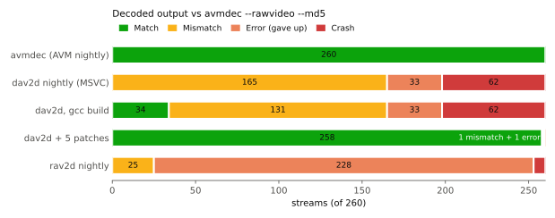
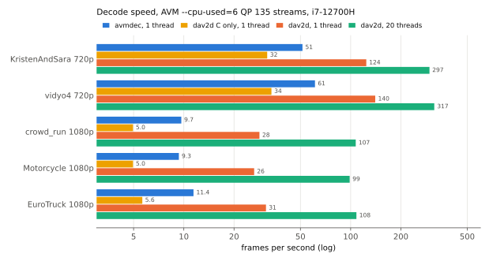

# AV2 decoder conformance: dav2d and rav2d vs AVM (20 Oct 2026)

Do the independent AV2 decoders produce the same pictures as AVM's
reference decoder `avmdec`? Every AV2 stream made in this repo so far (260
streams) was decoded with each decoder, and the MD5 of the decoded planes was
compared with `avmdec --rawvideo --md5`.

**Result:** the dav2d nightly build matched none of them, and a plain gcc build
of the same commit matched 34 (13%). Five fixes, all in [patches](patches/),
bring dav2d to 258 of 260, with no crashes. The two left are a missing
feature and one open bug, both described below. rav2d rejects most streams.

| Decoder | Match | Mismatch | Error | Crash |
|---|---:|---:|---:|---:|
| `avmdec` nightly (AVM f1328e2ad1) | 260 | 0 | 0 | 0 |
| dav2d nightly (dfbd7ac799, MSVC) | 0 | 165 | 33 | 62 |
| dav2d dfbd7ac799, gcc | 34 | 131 | 33 | 62 |
| dav2d + 5 patches, gcc | 258 | 1 | 1 | 0 |
| dav2d + 5 patches, MSVC | 258 | 1 | 1 | 0 |
| rav2d nightly (c3433024f5) | 0 | 25 | 228 | 7 |

Crash: access violation (dav2d) or Rust panic (rav2d). Error: the decoder
gave up ("Error parsing OBU data", "invalid or corrupt bitstream data").
All decoders ran single-threaded on Windows x64; the patched builds were also
checked with `--threads 4 --framedelay 4` on the dav2d test vectors and the
streams that the patches fix.

## Streams

| Set | Streams | Made with | What |
|---|---:|---|---|
| samples | 10 | AVM `main` 01803db, `--cpu-used=9` | 270p/360p, QP 110-235, 130 frames ([samples-v1](https://github.com/EwoutH/AV2/releases/tag/samples-v1)) |
| hd | 80 | AVM `av2-enc` 9c72cb56a, `--cpu-used=6` | 720p-2048x1080, 8- and 10-bit, HDR10, screen content, film grain, global motion, tiles, low delay ([hd-streams-2026-10](https://github.com/EwoutH/AV2/releases/tag/hd-streams-2026-10)) |
| sweep | 170 | AVM `av2-enc` 89eae123d, `--cpu-used` 0-9 | 4 QPs on 270p-1080p clips, from the [preset sweep](../2026-10-14-avm-preset-sweep/) and the cross-codec run |

The reference is `avmdec` from the AVM build that made each stream. The
latest AVM nightly gives the same output on all 260, so AVM's decoder output
has not changed over these commits. dav2d checks itself against AVM's
`av2-normative` branch. Its `avmdec` (14f43e4cd) also gives the same output as
the `av2-enc` one on the streams I checked, so the mismatches below are
dav2d bugs, not version differences.

## A pitfall: `avmdec --md5` is not a pixel MD5

Without `--rawvideo`, `avmdec` writes Y4M, and `--md5` then hashes the
**Y4M file including the stream header and every `FRAME` line**. That is what
the manifests in the sample releases hold. dav2d's md5 muxer hashes only the
pixels. dav2d also writes a different Y4M header (`F420:13 Ip A1:1 C420`
against `F60:1 Ip C420jpeg`), so even whole-file hashes differ. Use
`avmdec --rawvideo --md5` to compare decoders. Our decoder nightly compared
the two kinds of hash, so it reported a mismatch every night whether or not
the pictures agreed ([fixed](../../ci/decode_test.py) to compute the
reference with the AVM nightly).

## dav2d: what was wrong

Each fix was found by encoding 2-frame streams that change one `avmenc`
option at a time, then diffing a symbol-level trace, or dav2d's own
`test-debian-avm` debug logs (its `patches/` applied to `av2-normative`),
between dav2d and AVM.

1. **MSVC drops a designated initializer** ([0001](patches/0001-Work-around-MSVC-dropping-a-designated-initializer-i.patch)).
   `splat_intraref()` initializes `.mv[0].n = INVALID_MV, .mv[1].n = INVALID_MV`.
   MSVC 19.51 keeps only the last of the two, at every optimization level
   ([repro](msvc-repro/repro.c)). Intra blocks were then stored with a zero
   motion vector and showed up as IntraBC candidates. On MSVC builds this
   failed 5 of dav2d's 10 own test vectors (lossless, partial lossless,
   delta-q, quantizer matrices, film grain), and it is why the nightly matched
   nothing. Trigger: a designator `.arr[i].m` into an array of unions inside a
   struct, where `m` is not the union's first member, followed by a designator
   for another element of that array.
2. **Frame-level DRL bits off by one** ([0002](patches/0002-Fix-frame-level-max-DRL-bits-parsing.patch)).
   `max_drl_bits` was read with the wrong alphabet size and reference
   (3 and `def` instead of 5 and `def - 1`). Every inter frame with
   `allow_frame_max_drl_bits` set desynced. `avmenc` sets it from
   `--cpu-used 2` up.
3. **Loop restoration with 64x64 superblocks: coefficients read too early**
   ([0003](patches/0003-Read-chroma-loop-restoration-coefficients-between-SD.patch)).
   With 64x64 superblocks, intra frames split the luma and chroma trees at
   the superblock root (SDP), and AVM reads the chroma restoration
   coefficients after the luma tree. dav2d read them first. This also resolves
   the `FIXME: unit_sz_log2 can be 6` assert. `avmenc` uses 64x64 superblocks
   below 4K from `--cpu-used 2`.
4. **32-sample chroma restoration units** ([0004](patches/0004-Filter-chroma-in-32-sample-stripes-for-32-sample-res.patch)).
   Chroma was filtered in 64-sample stripes with one unit per stripe, so the
   right half of each stripe used the wrong unit. Small chroma errors on small
   frames from `--cpu-used 2` up (11 streams, 270p-360p).
5. **Deblocking with a zero side threshold** ([0005](patches/0005-Skip-deblocking-edges-whose-side-threshold-is-zero.patch)).
   AVM skips an edge when either (averaged) threshold is zero. dav2d didn't,
   which left a few pixels off by 1 on 10-bit content with a negative
   deblocking delta (9 of the 10-bit HD streams).

dav2d's own test vectors still pass with all five (C and asm, single- and
multi-threaded). The patches apply to dav2d `main` (8266278); none of them
needed an asm change.

**Still open:**

- **Several tile groups per frame** (`old_town_cross` with
  `--tile-columns=2 --tile-rows=1 --num-tile-groups=4`): every tile group OBU
  resets the frame header and tile list, so the second one fails. Not
  implemented.
- **Global motion** (`Shaky_Quad` with `--enable-global-motion=1`): one region
  of frame 84 (237 luma samples from (1412, 268), off by up to 4) differs
  with all in-loop filters off, so it is in prediction, probably the warp.

## Decoding speed

dav2d with the five patches (MSVC build, AVX2 asm) against the AVM nightly
`avmdec`, on HD streams from the hd set (`--cpu-used=6`, QP 135, one tile),
on the otherwise idle i7-12700H. Median of 2 runs; every run's MD5 matched
`avmdec`. [`bench_decode.py`](scripts/bench_decode.py),
[`bench_decode.jsonl`](bench_decode.jsonl).

| Stream | Frames | avmdec, 1 thread | dav2d, 1 thread | dav2d, 20 threads | dav2d C only, 1 thread |
|---|---:|---:|---:|---:|---:|
| KristenAndSara 720p | 600 | 51 fps | 124 fps | 297 fps | 32 fps |
| vidyo4 720p | 600 | 61 fps | 140 fps | 317 fps | 34 fps |
| crowd_run 1080p | 500 | 9.7 fps | 28 fps | 107 fps | 5.0 fps |
| Motorcycle 1080p | 130 | 9.3 fps | 26 fps | 99 fps | 5.0 fps |
| EuroTruckSimulator2 1080p | 130 | 11.4 fps | 31 fps | 108 fps | 5.6 fps |

- **dav2d is 2.3-2.9x faster than `avmdec` on one thread, and decodes
  1080p at about 100 fps with 20 threads** (frame and tile-row threading).
  `avmdec --threads=20` gives no speed-up on these single-tile streams.
- **The speed is in the asm:** with `--cpumask 0` (C only), dav2d is about
  half as fast as `avmdec`.

## rav2d

rav2d 0.3.0 rejects 228 streams as "invalid or corrupt bitstream data" and
panics on 7 (`recon.rs:414` slice index out of range, `decode.rs:11190`
index out of bounds, on `--cpu-used 1` 720p/1080p streams). The 25 it decodes
all differ from `avmdec`. It writes the frame rate inverted in its Y4M
header (`F1:60`).

## Reproduce

The scripts expect the local work folder layout (`samples/av2_work/`):
`conform.py` decodes every stream with every decoder (resumable, E-cores,
below-normal priority) into `conform.jsonl`; `summarize.py` prints the table.
`scripts/make_figures.py` redraws both figures from the two `.jsonl` files
in this folder.
`conform.jsonl` here has one row per (stream, decoder): exit code, MD5, wall
time. The truncated `crowd_run_1080p50_qp110_s4_33f.ivf` (18 of 33 frames,
left from an interrupted sweep) is excluded. The unpatched dav2d rows were
decoded without `--filmgrain 1`, which only matters for the one film grain
stream.
