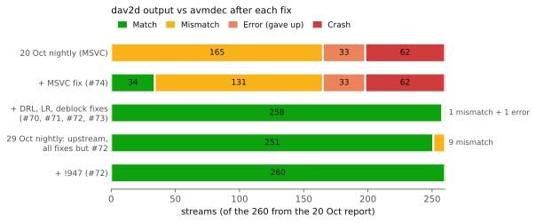
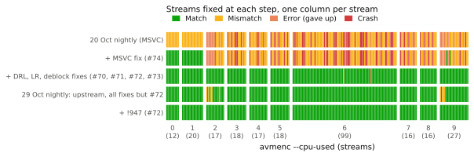

# dav2d conformance update: upstream `main` vs AVM (29 Oct 2026)

Follow-up to the [20 Oct decoder conformance report](../2026-10-20-av2-decoder-conformance/).
That report found five dav2d bugs and one missing feature, and fixed dav2d
with local patches. All of them have since been fixed in dav2d itself. Does
unpatched upstream dav2d now decode AVM streams correctly?

**Result:** yes. dav2d `main` with
[!947](https://code.videolan.org/videolan/dav2d/-/merge_requests/947), the
last fix, matches `avmdec` on all 284 AVM streams, with no errors or
crashes. dav2d no longer needs any of our patches.

> **Correction, 30 Oct:** these counts leave out
> `crowd_run_1080p50_qp110_s4_33f.ivf`, which we took for a truncated file.
> It is complete: its 18 IVF packets hold all 33 frames, because hidden
> frames share a packet with the next shown frame. dav2d decodes it wrong
> because of a separate bug, found on 30 Oct (implicit MV refinement for a
> compound block that uses the same reference twice; F8 in the
> [stress test](../2026-10-30-dav2d-stress/)). So `main` + !947 matches 284
> of 285 streams, and 285 of 285 with that fix.

| Decoder | Match | Mismatch | Error | Crash |
|---|---:|---:|---:|---:|
| dav2d nightly 20 Oct (dfbd7ac799, MSVC) | 0 of 260 | 165 | 33 | 62 |
| dav2d + 5 patches, 20 Oct | 258 of 260 | 1 | 1 | 0 |
| dav2d nightly 29 Oct ([fdc99363ea](https://github.com/EwoutH/AV2/releases/tag/dav2d-nightly-20261029-fdc99363ea), before !947) | 275 of 284 | 9 | 0 | 0 |
| dav2d `main` (45609d91) + !947, MSVC | **284 of 284** | 0 | 0 | 0 |

The 284 streams are the 260 from the first report plus 24 1080p streams
from the preset sweep (`--cpu-used` 3 and 6, 33 frames), all made with AVM
`av2-enc`. The reference is again `avmdec --rawvideo --md5` from the AVM
build that made each stream. All decoders ran single-threaded on Windows
x64, MSVC builds with AVX2 asm.

## Per fix

Both charts use the 260 streams of the first report, so every step is
measured on the same set. No new runs were made for them: each step is a
build that was already tested in one of the two reports. Fixes #70-#73 were
only ever tested together on the full set. The table gives their separate
reach from the 2-frame isolation tests behind each issue.

| Issue | Fix | Streams it affects | Source |
|---|---|---|---|
| [#74](https://code.videolan.org/videolan/dav2d/-/issues/74) MSVC drops a designated initializer | !898 (Martin Storsjö) | every stream, on MSVC builds only. With it, 34 match: the `--cpu-used` 0 and 1 streams and 2 others | measured |
| [#70](https://code.videolan.org/videolan/dav2d/-/issues/70) frame-level DRL bits | !919 | every inter frame with `allow_frame_max_drl_bits`, which `avmenc` sets from `--cpu-used 2` | isolation |
| [#71](https://code.videolan.org/videolan/dav2d/-/issues/71) loop restoration with 64x64 superblocks | !920 | 64x64 superblocks, which `avmenc` uses below 4K from `--cpu-used 2` | isolation |
| | #70-#73 together | 224 more streams match (34 to 258), all from `--cpu-used 2` up | measured |
| [#72](https://code.videolan.org/videolan/dav2d/-/issues/72) 32-sample chroma restoration units | [!947](https://code.videolan.org/videolan/dav2d/-/merge_requests/947) (Kyle Siefring) | 9 streams: 270p-360p, 8-bit, `--cpu-used` 2 and 9 | measured |
| [#73](https://code.videolan.org/videolan/dav2d/-/issues/73) deblocking with a zero side threshold | !931 and 61f5d7b7 (Kyle Siefring) | 9 10-bit HD streams with a negative deblocking delta | isolation |
| [#75](https://code.videolan.org/videolan/dav2d/-/issues/75) several tile groups per frame | 13ad8f12 (Peter de Rivaz) | 1 stream: `old_town_cross` with four tile groups | measured |
| [#76](https://code.videolan.org/videolan/dav2d/-/issues/76) global motion | !923 (Peter de Rivaz) | 1 stream: `Shaky_Quad` with global motion | measured |

The per-stream chart shows the pattern: after the MSVC fix, everything from
`--cpu-used 2` up still fails, because the DRL and 64x64 loop restoration
bugs hit almost every stream at the faster presets. The 9 streams left on the
29 Oct nightly are all small clips (270p-360p) at `--cpu-used` 2 and 9.

## The last fix: #72

Before !947, 9 streams still differed: all small 8-bit ones (270p-360p,
`--cpu-used` 2 and 9). Chroma was filtered in 64-sample stripes with one
restoration unit per stripe, so with 32-sample units the right half of each
stripe used the wrong unit.

!947 reverts the commit that made chroma run in 64-wide chunks, as agreed
in #72, so our own fix (!921) was not needed. It also stops the AVX2 Wiener
chroma filter from reading past the picture. It makes all 9 streams match,
single-threaded and with `--threads 4 --framedelay 4`. All other 275 streams
still match.

## Reproduce

- [`conform_nightly.jsonl`](conform_nightly.jsonl): the 29 Oct nightly
  (before !947).
- [`conform_main_mr947.jsonl`](conform_main_mr947.jsonl): `main` + !947.

Both have one row per (stream, decoder), including the `avmdec` reference
rows, in the same format as the first report.
[`scripts/run_conform.py`](scripts/run_conform.py) runs that report's
`conform.py` with a single decoder, reusing its reference MD5s. 
`crowd_run_1080p50_qp110_s4_33f.ivf` is again excluded, as truncated; it
isn't (see the correction above). The
`main` + !947 build is a shared-library build, so `dav2d.dll` has to sit
next to `dav2d.exe`.
`scripts/make_figures.py` redraws both figures from the two `.jsonl` files
here and the first report's `conform.jsonl`.
