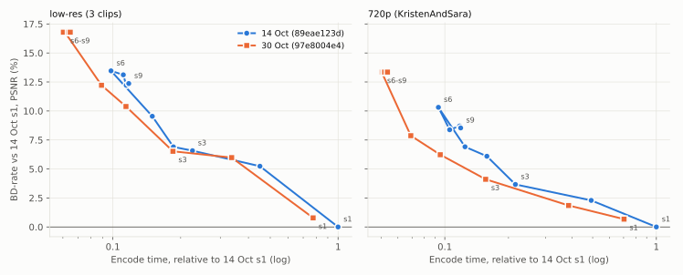

# AVM encoder: two weeks of av2-enc (14 Oct vs 30 Oct 2026)

How much faster did AVM's `av2-enc` branch get in the 77 commits between 14
and 30 October, and what did it cost in compression? Both builds ran side by
side on the same machine, with the same clips and settings as the
[14 Oct preset sweep](../2026-10-14-avm-preset-sweep/).

- **Old:** `av2-enc`
  [`89eae123d`](https://github.com/AOMediaCodec/avm/commit/89eae123d) (14 Oct, the
  build from the preset sweep).
- **New:** `av2-enc`
  [`97e8004e4`](https://github.com/AOMediaCodec/avm/commit/97e8004e4) (30 Oct).
- **Machine:** Intel Core i7-12700H laptop, Windows 11, MSVC 19.51 Release
  builds with the same CMake flags.

## Findings

1. **The new build is faster at every preset.** At the same `--cpu-used`, it
   takes 0.70-0.82x the time at s1-s3 and 0.44-0.63x at s4-s9. At 720p, s6 went from
   4.9 to 2.6 s per frame.
2. **At the same preset, it costs a few percent of bits.** At s1-s3 the
   BD-rate is about the same (-0.4% to +0.8% PSNR). At s4-s9 it's +2.5% to
   +3.9% on the low-res clips and 0% to +4.8% at 720p.
3. **Overall the trade-off improved, most at 720p.** Compared with the old
   build's s1, the new s4 at 720p reaches +6.2% in 0.095x the time. The old
   build needed s4 (0.158x) for the same BD-rate. The new s5 (0.069x, +7.9%)
   beats the old s6 (0.093x, +10.3%) on both time and bits. On the low-res clips the
   curves overlap from s1 to s3. Only the new s4 and faster add points that
   the old build couldn't reach.
4. **s6 to s9 are now one preset.** On the new build, `--cpu-used` 6, 7, 8
   and 9 write byte-identical streams (all 16 clip/QP pairs). On 14 Oct, s7-s9
   were slower than s6 and slightly better. The new s6 is the fastest point
   tested: 0.05x of the old s1 at 720p for +13.4% bits.
5. **The comparison is stable.** The old build reproduced all 144 of its
   14 Oct encodes byte for byte, and its encode times this night were within
   0.8% of 14 Oct (geometric mean, range 0.88-1.29x per encode).

## Setup

| | |
|---|---|
| Clips (8-bit 4:2:0, AV2 CTC set) | FourPeople 480x270, BlueSky 640x360, Vertical_Bayshore 270x480 (33 frames each); KristenAndSara 1280x720 (65 frames) |
| Presets | `--cpu-used` 1-9 (s0 left out: 6-11x slower than s1) |
| QPs | 110, 145, 180, 210 (`--end-usage=q --qp=<QP>`) |
| Command | `avmenc <clip>.y4m -o out.ivf --ivf --limit=<frames> --end-usage=q --qp=<QP> --cpu-used=<preset> --threads=1 --psnr=1` |
| Parallelism | 6 encodes at a time, 1 thread each, pinned to its own P-core. Old and new encodes of each job were queued next to each other. The E-cores ran quality scoring and an unrelated decoder test at below-normal priority. |
| Metrics | As in the 14 Oct sweep: payload bytes; PSNR YUV 6:1:1 from `avmenc`; SSIM-Y (dB) and VMAF from ffmpeg on the `avmdec` output; BD-rate with PCHIP over the 4 QPs |

288 of 288 encodes finished (00:26-04:56). For all 288, ffmpeg's PSNR-Y
matched `avmenc`'s within 0.05 dB.

## Results

### New vs old at the same preset

Time ratio (new/old, geometric mean) and BD-rate of the new build against the
old one at the same preset. Negative BD-rate = new needs fewer bits.

| preset | low-res: time | BD PSNR | BD SSIM | BD VMAF | 720p: time | BD PSNR | BD SSIM | BD VMAF |
|---|--:|--:|--:|--:|--:|--:|--:|--:|
| s1 | 0.78x | +0.8% | +0.8% | -0.4% | 0.70x | +0.7% | +0.6% | +0.1% |
| s2 | 0.75x | +0.8% | +1.3% | +0.5% | 0.78x | -0.4% | -1.0% | -0.8% |
| s3 | 0.82x | -0.1% | +0.1% | -1.5% | 0.72x | +0.3% | +0.4% | -0.7% |
| s4 | 0.62x | +3.2% | +3.1% | +1.2% | 0.60x | +0.0% | -0.2% | -2.0% |
| s5 | 0.60x | +2.5% | +2.2% | +0.1% | 0.55x | +0.8% | -0.1% | +0.6% |
| s6 | 0.62x | +2.9% | +2.9% | +3.0% | 0.54x | +2.9% | +1.3% | +1.9% |
| s7 | 0.54x | +3.1% | +3.0% | +3.4% | 0.48x | +4.8% | +4.0% | +4.3% |
| s8 | 0.56x | +3.9% | +3.6% | +2.9% | 0.44x | +4.4% | +3.1% | +2.9% |
| s9 | 0.55x | +3.8% | +4.1% | +2.9% | 0.45x | +4.6% | +3.4% | +3.6% |

### Both builds against the old s1

Time and BD-rate (PSNR) relative to the 14 Oct build at s1, the data behind
the figure.

| preset | low-res old | low-res new | 720p old | 720p new |
|---|--:|--:|--:|--:|
| s1 | 1.000x, 0% | 0.775x, +0.8% | 1.000x, 0% | 0.704x, +0.7% |
| s2 | 0.450x, +5.2% | 0.337x, +6.0% | 0.492x, +2.3% | 0.385x, +1.9% |
| s3 | 0.226x, +6.6% | 0.185x, +6.5% | 0.216x, +3.7% | 0.156x, +4.1% |
| s4 | 0.186x, +6.9% | 0.114x, +10.4% | 0.158x, +6.1% | 0.095x, +6.2% |
| s5 | 0.150x, +9.5% | 0.089x, +12.2% | 0.125x, +6.9% | 0.069x, +7.9% |
| s6 | 0.098x, +13.5% | 0.061x, +16.8% | 0.093x, +10.3% | 0.050x, +13.4% |
| s7 | 0.111x, +13.1% | 0.060x, +16.8% | 0.105x, +8.4% | 0.051x, +13.4% |
| s8 | 0.115x, +12.2% | 0.064x, +16.8% | 0.118x, +8.7% | 0.052x, +13.4% |
| s9 | 0.118x, +12.4% | 0.065x, +16.8% | 0.119x, +8.5% | 0.054x, +13.4% |

Per clip, see `summary.txt`. The per-clip spread is large at the fast
presets: on Vertical_Bayshore, for example, the new s4 is +7.3% against the
old s4.

## What changed upstream

The 77 commits are mostly encoder speed work: pruning in the partition,
compound, warp and transform-type searches (several gated on `speed >= 4` or
`>= 6`), dry-pass shortcuts, and SIMD (AVX2/AVX-512/NEON). Some also add
encoder multithreading (CDEF/CCSO, LR, GDF, TIP), which does not apply here
(`--threads=1`). The decoder-side changes are SIMD and a default render size:
the old and new `avmdec` give identical output on 44 streams checked from
both builds.

## Limits

- Short clips (33 and 65 frames), 4 QPs, one 720p clip, no 1080p.
- Single-threaded encodes. The multithreading commits may matter more than
  this shows.
- The E-cores were busier than on 14 Oct. The old build's times matched
  14 Oct within 1%, and old and new ran under the same conditions.

## Files

- `sweep2.jsonl`: one row per encode (includes per-frame times and sizes).
- `results.csv`: the main columns of the same data.
- `summary.txt`: per-clip tables (output of `compare2.py`).
- `night.log`: the run log.
- `scripts/`: `sweep2.py` (the 14 Oct `sweep.py` with a `build` field),
  `run_sweep2.sh`, `compare2.py` (tables and figure; imports
  `analyze_sweep.py`).
