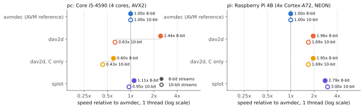
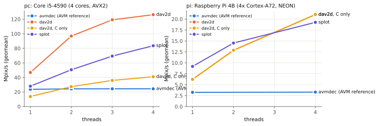
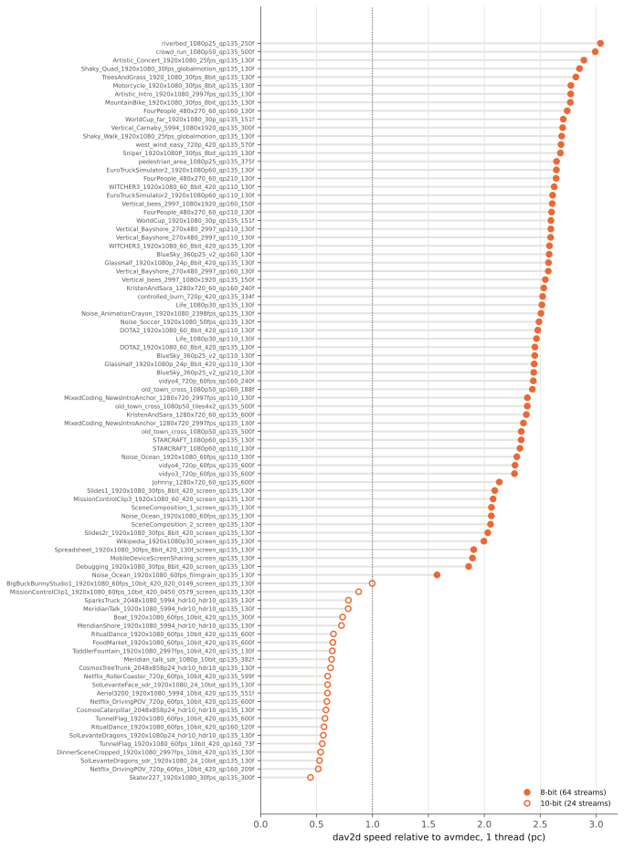

# AV2 decode speed on x86 and a Raspberry Pi (2-3 Nov 2026)

How fast do today's AV2 decoders run on a modest desktop CPU and on a
Raspberry Pi, and do they decode correctly? Five decoders ran on the 88 AV2
sample streams of this repo overnight. Each decode was checked against the AVM
reference decoder, `avmdec`.

- **Machines:**
  - **pc:** Intel Core i5-4590, 4 cores at 3.3-3.7 GHz, AVX2, 16 GB RAM, NixOS.
  - **pi:** Raspberry Pi 4B, 4x Cortex-A72 at 1.5 GHz, NEON, 2 GB RAM, NixOS.
- **Decoders:** all at their 2 Nov HEAD:
  - `avmdec`: AVM `av2-enc`
    [`d953d2e`](https://github.com/AOMediaCodec/avm/commit/d953d2e).
  - dav2d [`9b5d2f6e`](https://code.videolan.org/videolan/dav2d/-/commit/9b5d2f6e).
  - rav2d 0.4.2 [`cf41e91`](https://github.com/stukenov/rav2d/commit/cf41e91).
  - rusty_av2d [`9c8f6e6`](https://github.com/Remade-With-Rust/rusty_av2d/commit/9c8f6e6).
  - splot [`b682f58`](https://github.com/splotlabs/splot/commit/b682f58).

## Findings

1. **dav2d is fast on 8-bit and slow on 10-bit on x86.** On one thread of the
   pc, dav2d decodes 8-bit streams 2.44x as fast as `avmdec` (64 streams,
   range 1.6-3.0x). On 10-bit streams it is slower than `avmdec`: 0.63x (24
   streams, range 0.45-1.0x). Its x86 asm makes 8-bit 4.5x faster than its C
   code, but 10-bit only 1.5x. `avmdec` is about as fast on 10-bit as on 8-bit.
2. **On the pi, splot is the fastest on one thread and dav2d gains little from
   NEON.**
   - On one thread, splot runs at 2.8x (8-bit) and 3.0x (10-bit) the speed of
     `avmdec`, against 2.0x and 1.7x for dav2d.
   - dav2d's NEON code makes it only 1.33x (8-bit) and 1.23x (10-bit) faster
     than its C build. On x86, asm makes it 4.5x faster.
   - The aarch64 port has 20 asm files against 41 for x86. Deblocking, CCSO,
     the secondary transform, palette and `refmvs` have x86 asm but no aarch64
     asm. Entropy decoding has aarch64 asm for bools only; multi-symbol
     decoding (`symbol_adapt4`/`adapt8`) is asm on x86 only. That is the
     likely reason (not profiled).
3. **dav2d and splot use extra threads; `avmdec` doesn't.**
   - **dav2d on 4 threads:** 2.7x its 1-thread speed on the pc and 3.4x on the
     pi.
   - **splot on 4 threads:** 3.0x on the pc and 2.1x on the pi. On the pi,
     splot leads at 1 and 2 threads and dav2d leads at 4 (21.0 vs 19.3 Mpix/s).
   - **`avmdec`:** 4 threads add nothing on single-tile streams (24.4 vs
     23.7 Mpix/s). On the one 4x2-tile stream it gains 1.4x on the pc.
4. **At 1080p, only the pc with dav2d decodes in real time.** Geometric means
   over the 1080p streams on 4 threads:

   | | 8-bit | 10-bit |
   |---|---|---|
   | dav2d on the pc | 85 fps | 27 fps |
   | splot on the pc (core set: 6 and 1 streams) | 42 fps | 34 fps |
   | dav2d on the pi (6 and 1 streams) | 11 fps | 7 fps |
   | splot on the pi | 9 fps | 9 fps |
   | `avmdec` on the pc | 14 fps | 12 fps |

5. **Only `avmdec`, dav2d and splot decode correctly.**
   - **dav2d:** matched `avmdec` on all 88 streams, on both machines and at every
     thread count.
   - **splot:** also matched on all of them. It has no MD5 output, so it was
     checked separately: its raw output was hashed in an untimed pass.
   - **rav2d 0.4.2:** stopped with "invalid or corrupt bitstream data" on most
     streams. On the others, its output differs from `avmdec`.
   - **rusty_av2d:** decoded the 4 small streams with wrong output, at about
     3 fps at 270p on the pc.
   - Neither rav2d nor rusty_av2d has speed numbers here. Both probably follow
     an older AVM version than these streams; that was not checked.

## Setup

| | |
|---|---|
| Streams | All 88 streams of the [`samples-v1`](https://github.com/EwoutH/AV2/releases/tag/samples-v1) and [`hd-streams-2026-10`](https://github.com/EwoutH/AV2/releases/tag/hd-streams-2026-10) releases. 64 are 8-bit and 24 are 10-bit, all 4:2:0. Sizes run from 270p to 2048x1080. Most are 1080p, encoded at `--cpu-used 6`. |
| Core set | 13 of them ([`data/streams_core.tsv`](data/streams_core.tsv)): 270p to 1080p, two 10-bit, screen content, film grain, a 4x2-tile stream and QPs 110-210. The pi ran only this set. |
| Reference | Today's `avmdec` reproduces the manifest MD5 of all 88 streams. Its pixel MD5 (`--rawvideo --md5`) is the reference for every decoder. |
| Builds | GCC 15.3, release. pc: native. pi: cross-compiled on the pc and statically linked. Rust: rav2d and rusty_av2d with 1.95.0; splot with its pinned `nightly-2026-07-22`, since it needs rustc 1.99 or newer. dav2d was also built with `-Denable_asm=false` ("no asm"). |
| Commands | `avmdec <ivf> --rawvideo --md5 --threads=N`; `dav2d -i <ivf> --muxer md5 -o - --threads N --filmgrain 1`; `rav2d <ivf> --md5 -t N`; `splot decode <ivf> --output-format null --threads N`. Film grain is applied by every decoder. |
| Runs | One decode at a time. Each run records wall time, CPU time, peak memory, CPU frequency, temperature and the CPU used by other processes. A run waits while `nixos-upgrade`, `job-*`, `btrbk` or `nix-gc` is active. On the pi, streams are read from `/dev/shm`. |
| Repeats | pc: core set 3x at 1-4 threads, the full corpus 2x (`avmdec`, dav2d at 1 and 4 threads) or 1x (others). pi: 2x at 1 thread, 1x at 2 and 4. The median per stream is kept. |
| Time | pc 22:46-04:58, pi 22:43-05:18, the no-asm follow-up until 05:49 |

Speeds are in Mpix/s (luma pixels times frames, divided by wall time), so that
streams of different sizes can be pooled. Ratios between decoders are per
stream and then averaged as a geometric mean.

## Results

### Speed relative to avmdec, 1 thread

Each row covers the streams that both that decoder and `avmdec` decoded on
that host. On the pc that is all 88 streams, except the no-asm build (core set
only). On the pi it is the core set: 11 8-bit and 2 10-bit streams.

| host | decoder | 8-bit | 10-bit |
|---|---|---|---|
| pc | dav2d | 2.44x | 0.63x |
| pc | dav2d, no asm | 0.55x | 0.43x |
| pc | splot | 1.11x | 0.95x |
| pi | dav2d | 1.96x | 1.69x |
| pi | dav2d, no asm | 1.47x | 1.38x |
| pi | splot | 2.79x | 3.00x |

`avmdec` runs at 27.7 (8-bit) and 23.8 Mpix/s (10-bit) on the pc, and at 3.5
and 2.2 Mpix/s on the pi.

### Thread scaling, core set

Geometric mean Mpix/s over the core streams:

| host | decoder | 1 | 2 | 3 | 4 threads |
|---|---|---|---|---|---|
| pc | avmdec | 23.7 | 24.3 | 24.3 | 24.4 |
| pc | dav2d | 46.9 | 96.9 | 119.2 | 126.3 |
| pc | dav2d, `--cpumask 0` | 13.8 | 27.4 | 35.9 | 41.0 |
| pc | splot | 28.0 | 50.6 | 69.3 | 83.6 |
| pi | avmdec | 3.3 | | | 3.3 |
| pi | dav2d | 6.2 | 12.9 | | 21.0 |
| pi | splot | 9.2 | 14.5 | | 19.3 |

The pc is about 7.6x as fast as the pi for dav2d on one thread, and 6.0x on
four.

### dav2d per stream

Every 10-bit stream is at 1.0x or below, and every 8-bit stream is at 1.58x or
above. Among the 8-bit streams, screen content (1.9-2.1x) and the film-grain
stream (1.6x) are the slowest. On 4 threads, dav2d is 6.2x as fast as
`avmdec` on 8-bit (3.3-9.4x) and 2.2x on 10-bit (1.6-2.6x).

### Memory

Peak RSS at 1080p on the pc, median per run: `avmdec` 313 MB at any thread
count; dav2d 38 MB on 1 thread and 78 MB on 4; splot 60 MB on 1 thread and
196 MB on 4.

## Limits

- **`--cpumask 0` is not C-only in release builds of dav2d.** dav2d sets
  `TRIM_DSP_FUNCTIONS` in release builds, so the target's baseline SIMD stays
  on. That is SSE2 on x86-64 and all of NEON on aarch64.
  - On the pi, the `--cpumask 0` series ran the same code as dav2d (same
    speed). It is left out of the tables, and the no-asm build was added for
    this comparison.
  - On the pc, `--cpumask 0` is 1.13x the no-asm build on 8-bit and equal on
    10-bit.
- **The 10-bit results on the pi rest on 2 streams.** The pc results rest on 24.
- **The pi measured fewer configurations.** No 3-thread runs and fewer repeats
  (2 at 1 thread, 1 at 2 and 4) than the pc.
- **The runner's own polling counts as other CPU use.** The runner polls the
  decoder every 2 ms. With 4 decoder threads on the pi's 4 cores, that reads as
  about 0.16 cores of other CPU use. Above 0.10 a run was redone, so many pi
  4-thread runs were repeated. From 04:30 the limit on the pi was 0.25 cores.
  The analysis keeps every attempt at or below 0.25 cores. The pc's median was
  0.02 cores.
- **The runs are repeatable.** The spread between repeats (max minus min over
  the median) has a median of 0.5% and a 90th percentile of 1.9% on the pc
  (522 cases). On the pi it is 0.2% and 0.8% (62 cases). The pc ran at turbo:
  a median of 3.7 GHz during runs, and at most 41 °C. The pi averaged 1.5 GHz
  during runs (lowest run mean 1.44 GHz) and reached at most 58 °C, well below the
  pi's 80 °C soft throttle point.
- **The streams are all from one encoder.** They come from AVM, mostly at
  `--cpu-used 6` and QP 135. Other encoders or presets may stress decoders
  differently.

## Files

- [`data/pc.jsonl`](data/pc.jsonl), [`data/pi.jsonl`](data/pi.jsonl): one row
  per run, every attempt included.
- [`data/verify_pc.jsonl`](data/verify_pc.jsonl),
  [`data/verify_pi.jsonl`](data/verify_pi.jsonl): the splot raw-output MD5
  check.
- [`data/summary.csv`](data/summary.csv): the median per host, decoder, stream
  and thread count, with Mpix/s, fps, peak memory and correctness.
  [`data/summary.md`](data/summary.md): the tables the analysis prints.
- [`data/streams_all.tsv`](data/streams_all.tsv), `streams_core.tsv`,
  `streams_small.tsv`: the stream lists with the reference pixel MD5.
  [`data/stream_format.tsv`](data/stream_format.tsv): bit depth per stream.
- [`scripts/`](scripts/):
  - `bench.py` runs the decodes.
  - `run_pc.sh`, `run_pi.sh` and `run_extra.sh` are the run plans as executed.
  - `build_*.sh` are the builds; `ref_md5.py`, `verify_raw.py` and
    `bitdepth.py` handle the reference MD5s, the splot check and bit depths.
  - `analyze.py` makes the tables and figures.
