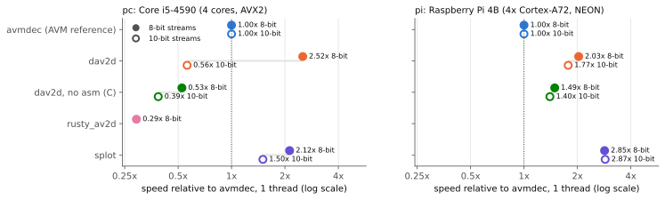
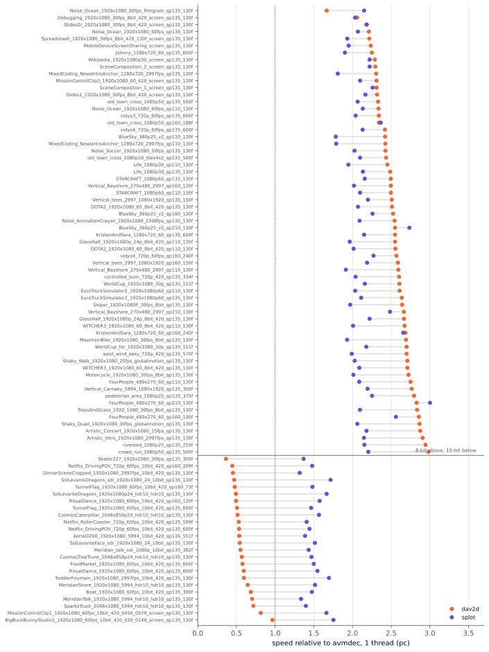
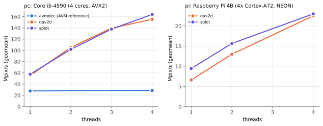

# AV2 decode speed, 14 Nov 2026: latest decoders, null output

A rerun of the [2 Nov decode benchmark](../2026-11-02-av2-decode-speed/) with each decoder's HEAD of 13-14 Nov, on the same two machines and the same 88 streams. Unlike 2 Nov, the timed runs write no output (no MD5), every timed run lasts about 1 s or more, and C and Rust are built with the same CPU tuning ([benchmark rules](../README.md#benchmark-rules)).

- **Machines:**
  - **pc:** Intel Core i5-4590, 4 cores at 3.3-3.7 GHz, AVX2, 16 GB RAM, NixOS.
  - **pi:** Raspberry Pi 4B, 4x Cortex-A72 at 1.5 GHz, NEON, 2 GB RAM, NixOS.
- **Decoders:**
  - `avmdec`: AVM `av2-enc` [`487d0761b`](https://github.com/AOMediaCodec/avm/commit/487d0761b) (13 Nov).
  - dav2d [`6fbce209`](https://code.videolan.org/videolan/dav2d/-/commit/6fbce209) (13 Nov).
  - splot [`dd566e10`](https://github.com/splotlabs/splot/commit/dd566e10) (11 Nov).
  - rusty_av2d [`552652b`](https://github.com/Remade-With-Rust/rusty_av2d/commit/552652b) (9 Nov).
  - rav2d had no new commits since 2 Nov (0.4.2, wrong output then), so it was left out.

## Findings

1. **splot doubled its speed on x86 in 12 days.**
   - Timed the same way on the pc, today's splot is 2.25x as fast as the 2 Nov binary on one thread (2.31x on 8-bit, 1.96x on 10-bit), and 2.29x on 4 threads.
   - On the pi it gained much less: 1.11x on one thread (1.14x on 8-bit, 0.95x on 10-bit).
2. **On x86, dav2d still leads on 8-bit and splot leads on 10-bit.**
   - **1 thread, all 88 streams:** dav2d is 2.52x as fast as `avmdec` on 8-bit and 0.56x on 10-bit. splot is 2.12x and 1.50x.
   - **Head to head:** splot runs at 0.84x dav2d's speed on 8-bit and 2.67x on 10-bit (1 thread). On 4 threads that is 0.88x and 2.30x.
   - On the core set (11 8-bit and 2 10-bit streams), the two are level: 55.5 and 57.7 Mpix/s on one thread, 155.5 and 164.1 Mpix/s on four.
   - dav2d's x86 asm makes 8-bit 4.8x faster than its C code, 10-bit only 1.46x. The 10-bit gap from 2 Nov is unchanged.
3. **On the pi, splot is fastest on 1 and 2 threads; on 4 threads splot and dav2d are level.**
   - **1 thread, core set:** splot is 2.85x `avmdec` on 8-bit and 2.87x on 10-bit. dav2d is 2.03x and 1.77x.
   - **4 threads:** 23.0 vs 22.5 Mpix/s; per stream, splot is 0.98x dav2d's speed on 8-bit and 1.26x on 10-bit.
   - NEON makes dav2d only 1.36x (8-bit) and 1.27x (10-bit) faster than its C build.
4. **dav2d and `avmdec` changed little since 2 Nov.** With the same null sink on the same machine, today's builds against the 2 Nov binaries:
   - dav2d: 1.03x on the pc and 1.00x on the pi.
   - `avmdec`: 1.08x on the pc. Part of that may be the x86-64-v3 build flags; the 2 Nov binary was built for generic x86-64.
5. **Null output makes the 2 Nov numbers look slow.** Compared with the 2 Nov results (MD5 output), today's speeds on the pc are:
   - `avmdec` 1.17x and dav2d 1.18x on one thread (1.23x on four).
   - For dav2d, almost all of that is the sink, not the code (see 4).
6. **At 1080p, the pc decodes in real time with dav2d and splot. The pi does not.** Geometric mean fps over the 1080p streams, 4 threads (number of streams in brackets):

   | | 8-bit | 10-bit |
   |---|---|---|
   | dav2d on the pc | 113 fps (44) | 31 fps (18) |
   | splot on the pc | 96 fps (44) | 70 fps (18) |
   | `avmdec` on the pc | 15 fps (6) | 12 fps (1) |
   | dav2d on the pi | 12 fps (6) | 8 fps (1) |
   | splot on the pi | 12 fps (6) | 9 fps (1) |

7. **rusty_av2d now decodes correctly, but slowly.**
   - On the 4 small streams its output matches `avmdec`; on 2 Nov all 4 were wrong.
   - It runs at 0.29x the speed of `avmdec` on the pc (7.6 Mpix/s, about 2x its 2 Nov speed).
   - Only these 4 streams were checked and timed.

## Setup

| | |
|---|---|
| Streams | The same 88 streams as on 2 Nov ([`samples-v1`](https://github.com/EwoutH/AV2/releases/tag/samples-v1) and [`hd-streams-2026-10`](https://github.com/EwoutH/AV2/releases/tag/hd-streams-2026-10)): 64 8-bit, 24 10-bit, 270p to 2048x1080. The pi and most series ran the 13-stream core set ([`data/streams_core.tsv`](data/streams_core.tsv)). |
| Output | Timed runs write no output, but still apply film grain: `avmdec --noblit`, `dav2d --muxer null`, splot `--output-format raw -o /dev/null` (splot's `null` mode skips film grain), rusty_av2d `--muxer null`. |
| Run length | A stream under 400 Mpix (width x height x frames) is decoded k times back to back within one timed run, one process per decode (k = 2 for most 130-frame 1080p streams, up to 24 for 270p; [`data/streams_all_rep.tsv`](data/streams_all_rep.tsv)). On the pc, 2 of 931 runs took just under 1 s (0.96 and 0.99 s). |
| Builds | GCC 15.3, release. pc: native, C at `-march=x86-64-v3` (the level splot's own config sets for Rust). pi: cross-compiled on the pc and statically linked, C and Rust at `cortex-a72`. splot with its pinned Rust 1.99.1 and fat LTO; rusty_av2d with its pinned nightly. dav2d also with `-Denable_asm=false` ("no asm"). |
| Output check | Untimed, separate pass on the pc: raw output MD5 against `avmdec --rawvideo --md5`. dav2d and splot (4 threads) matched on all 13 core streams, rusty_av2d on the 4 small ones. The pi was not checked; it runs the same source code. Conformance was not the aim of this run. |
| Runs | One decode at a time. Per run: wall time, CPU time, peak memory, CPU frequency, temperature, and the CPU used by other processes ("foreign"). The runner now blocks in `wait4` instead of polling every 2 ms, so its own CPU use no longer reads as foreign (median 0.02 cores on both machines). A run with more than 0.10 foreign cores was redone: 35 of 931 runs on the pc (another session was active from 15:00) and 5 of 188 on the pi. |
| Repeats | pc: core set 3x (`avmdec` at 1 and 4 threads, dav2d and splot at 1-4), no-asm dav2d 2x, the rest 1x; the whole corpus 1x at 1 and 4 threads (`avmdec` at 1 thread only). pi: 1x at 1, 2 and 4 threads, then dav2d and splot again at 1 and 4. The median per stream is kept. |
| Time | pc 14:23-18:19, pi 14:19-19:04 |

Speeds are in Mpix/s (luma pixels times frames, divided by wall time). Ratios between decoders are per stream, then averaged as a geometric mean.

## Results

### Speed relative to avmdec, 1 thread

On the pc: all 88 streams (no-asm dav2d: the core set; rusty_av2d: the 4 small streams). On the pi: the core set, 11 8-bit and 2 10-bit streams.

| host | decoder | 8-bit | 10-bit |
|---|---|---|---|
| pc | dav2d | 2.52x | 0.56x |
| pc | dav2d, no asm | 0.53x | 0.39x |
| pc | splot | 2.12x | 1.50x |
| pc | rusty_av2d | 0.29x | |
| pi | dav2d | 2.03x | 1.77x |
| pi | dav2d, no asm | 1.49x | 1.40x |
| pi | splot | 2.85x | 2.87x |

`avmdec` runs at 32.8 (8-bit) and 29.7 Mpix/s (10-bit) on the pc, and at 3.6 and 2.2 Mpix/s on the pi.

### Per stream, pc

dav2d is faster than splot on 59 of the 64 8-bit streams (54 on 4 threads). splot is faster on every 10-bit stream, by 1.8-3.8x on one thread. The film-grain stream is dav2d's slowest 8-bit stream relative to `avmdec` (1.67x).

### Thread scaling, core set

Geometric mean Mpix/s over the core streams:

| host | decoder | 1 | 2 | 3 | 4 threads |
|---|---|---|---|---|---|
| pc | avmdec | 27.8 | | | 28.7 |
| pc | dav2d | 55.5 | 105.3 | 139.6 | 155.5 |
| pc | splot | 57.7 | 101.9 | 138.0 | 164.1 |
| pi | dav2d | 6.6 | 13.0 | | 22.5 |
| pi | splot | 9.4 | 15.7 | | 23.0 |

`avmdec` on the pi ran 4 threads on the 4x2-tile stream only: 2.7 Mpix/s on 1 thread, 3.4 on 4. On the pc that stream gains 1.5x from 4 threads. The single-tile streams gain nothing.

### What changed since 2 Nov

Today's builds against the 2 Nov binaries, both timed now with the same null sink, core set, geometric mean of per-stream speed ratios:

| host | decoder | threads | 8-bit | 10-bit | all |
|---|---|---|---|---|---|
| pc | avmdec | 1 | 1.07x | 1.09x | 1.08x |
| pc | dav2d | 1 | 1.03x | 1.03x | 1.03x |
| pc | dav2d | 4 | 1.03x | 1.03x | 1.03x |
| pc | splot | 1 | 2.31x | 1.96x | 2.25x |
| pc | splot | 4 | 2.39x | 1.80x | 2.29x |
| pi | dav2d | 1 | 1.00x | 1.01x | 1.00x |
| pi | splot | 1 | 1.14x | 0.95x | 1.11x |

### Output sink

Same decoders on the core set, 1 thread, pc. These are wall-time ratios against the timed configuration:

- dav2d writing raw output to `/dev/null`: 1.02x the time of `--muxer null`.
- `avmdec` writing raw output to `/dev/null`: 1.015x the time of `--noblit`.
- splot in `null` mode: 0.98x the time of raw output to `/dev/null`. On the film-grain stream it is 0.77x, because `null` skips the grain.

The `/dev/null` sink costs almost nothing, so the 2 Nov difference (point 5) comes from computing the MD5.

## Limits

- **10-bit results on the pi rest on 2 streams**, and most series ran only the 13-stream core set.
- **Process start is timed k times on short streams.** Each decode in a repeated run starts a new process. That costs a few ms per decode, so the small streams on the fastest settings read slightly slow.
- **Looped streams did not work for dav2d.** Repeating the stream inside one IVF file (each copy starts with a key frame and sequence header) was tried first. `avmdec` and splot decode such files to k copies of the normal output, but dav2d rejects most frames after the first copy ("Error parsing frame header", 917 of 980 frames on BlueSky x14). This is still to be checked: it may be a dav2d bug.
- **The output was checked on the core set only**, on the pc. A raw-output MD5 from `avmdec` once did not match while the pc was busy building; three later tries matched, and it was not reproduced.
- **The streams are all from one encoder** (AVM, mostly `--cpu-used 6`, QP 135).

## Files

- [`data/pc.jsonl`](data/pc.jsonl), [`data/pi.jsonl`](data/pi.jsonl): one row per run, every attempt included. `frames` counts all decodes of a repeated run.
- [`data/verify_pc.jsonl`](data/verify_pc.jsonl): the output check.
- [`data/summary.csv`](data/summary.csv): the median per host, decoder, stream and thread count. [`data/summary.md`](data/summary.md): every table the analysis prints.
- [`data/streams_*_rep.tsv`](data/streams_all_rep.tsv): stream lists with reference MD5 and repeat count. [`data/stream_format.tsv`](data/stream_format.tsv): bit depth per stream.
- [`scripts/`](scripts/):
  - `bench.py` runs the decodes.
  - `run_pc.sh`, `run_pc_extra.sh`, `run_pi.sh` and `run_pi_rest.sh` are the run plans as executed. The pi run was cut short at 17:45 and finished with `run_pi_rest.sh`, which ran `avmdec` at 4 threads on the tiled stream only.
  - `build_*.sh` are the builds.
  - `make_repeats.py` makes the repeat counts, and `verify_raw.py` does the output check.
  - `analyze.py` makes the tables and figures.
