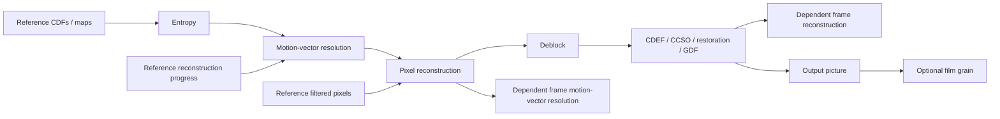

# Exploring dav2d threading, 19 November 2026

The most useful next investigation is to separate **worker count, frames in flight, and decoding passes**. They currently change together in ways that can hide the cause of a scaling regression. A scheduler rewrite is not justified by the evidence collected here.

This is research for discussion, not a proposed upstream submission. Nothing was posted upstream. The canonical dav2d checkout and existing conformance builds were left unchanged. The experimental source and binaries are disposable, ignored files under `.work/`.

## What was examined

- Current upstream `main`, `b130414d978a613671b6a14bf95040e2cba8d726`, checked against the public GitLab branch on 19 November. The canonical checkout was older, so source inspection and experiments used the existing round-5 checkout/build at this revision.
- `src/lib.c`, `thread_task.c`, `internal.h`, `decode.c`, `recon_tmpl.c`, `refmvs.c`, the public settings API, and their relevant git history.
- All 20 open upstream MRs and 14 open issues, plus threading MR history and the full discussions of issues #69 and #50. No open performance scheduler MR appeared in that snapshot; upstream's only branch was `main`. This does not establish what maintainers are working on privately or in unexamined forks.
- The existing 14 November measurements on the pc and Pi, reanalyzed for utilization and CPU cost.
- A randomized worker/frame-delay sweep, stopped after an encoder started competing for CPU; temporary worker instrumentation; and a small three-pass low-latency experiment.

The upstream roadmap lists [threading improvement](https://www.videolan.org/projects/dav2d/). The concrete performance problem already has an issue: [#69, slower at six/eight workers than four](https://code.videolan.org/videolan/dav2d/-/issues/69). Ronald Bultje reported this on four v15 720p CTC files (A31/A33 at Q135, A34/A36 at Q160), with dav1d control samples behaving differently. There were no comments or linked MRs in the issue when checked. Our public benchmark streams are not those exact CTC encodes.

## How threading works now

For one thread, decoding runs on the calling thread, with entropy decoding, motion-vector resolution and reconstruction combined. For multiple threads, dav2d creates a pool of `n_threads` workers; the calling thread still handles input/output and some bookkeeping.

| Configuration | Frames in flight | Block decoding passes |
|---|---:|---|
| One thread | 1 | All three operations together |
| Multiple workers, `--framedelay 1` | 1 | Entropy; motion-vector resolution + reconstruction |
| Multiple workers, frame delay > 1 | Multiple | Entropy; motion-vector resolution; reconstruction |

`--threads` is a pool size, not a division into dedicated frame workers and tile workers. Ready tasks from several frames, tiles, passes and filters share the pool. A tile's pass advances in superblock-row units. For a single tile, additional parallelism comes from passes, filters and overlapping frames; it cannot be obtained merely by assigning more workers to its sequential entropy decoder.

The scheduler uses a global mutex, sorted per-frame task lists and per-frame pending lists. Entropy tasks are prioritized within a frame; initialization is prioritized across frames; older frames are searched first. A worker can continue a ready tile pass into its next row without reacquiring the global lock. Thus, it is already more sophisticated than a global work queue with one lock acquisition for every decoded row.

The dependency chain is approximately:



This diagram omits tile boundaries, filter lookahead, TIP and error paths. The two reference dependencies differ deliberately. Entropy only waits for the selected segmentation/CCSO maps it needs; MV resolution only waits for relevant temporal-MV references; reconstruction uses per-row `lowest_pixel` requirements and filtered reference progress. Unnecessary reference waits were already removed in [!722](https://code.videolan.org/videolan/dav2d/-/merge_requests/722).

The separate MV pass was introduced in [!606](https://code.videolan.org/videolan/dav2d/-/merge_requests/606), because MV resolution is needed to determine which reference pixels reconstruction will access, while entropy should run ahead without those dependencies. [!617](https://code.videolan.org/videolan/dav2d/-/merge_requests/617) then allowed postfilters to overlap reconstruction and published prefilter progress for following frames' MV work. Filter slices were subsequently reduced to 64 pixels. Proposals to add these features would duplicate existing work.

**Why not publish temporal-MV readiness at the end of the MV pass?** `recon_tmpl.c:update_temporal()` writes the reference temporal-MV field during reconstruction, incorporating the reconstructed block's motion state. `refmvs.c` consumes that field for later frames. Advancing its readiness on the earlier pass alone is not a valid optimization without proving which data is final. Likewise, the reconstruction dependency's filter margin and motion footprint cannot simply be reduced to the current row.

## What the existing measurements tell us

Reanalysis of the [14 November benchmark](../2026-11-14-av2-decode-speed/), geometric means over streams with both one- and four-thread results:

| Host / group | Streams | Four-thread speedup | Busy cores at four threads | CPU time relative to one thread |
|---|---:|---:|---:|---:|
| pc, 8-bit | 64 | 2.73× | 3.13 | 1.15× |
| pc, 10-bit | 24 | 3.56× | 3.77 | 1.06× |
| pc, screen in filename | 11 | 2.49× | 2.93 | 1.18× |
| Pi, 8-bit | 11 | 3.38× | 3.53 | 1.05× |
| Pi, 10-bit | 2 | 3.58× | 3.62 | 1.02× |

The screen group overlaps the bit-depth groups and is a filename classification, not a parsed feature classification. The pc has much faster 8-bit SIMD than 10-bit SIMD. These observations suggest that faster pixel kernels expose dependency/coordination costs: the weaker-scaling streams both use fewer cores and consume more total CPU. They do not isolate whether the extra cost is cache effects, memory traffic, synchronization, extra passes, or clock differences. Four-core turbo also differs from single-core turbo.

For example, FourPeople 270p Q210 scales only 1.67×, uses about 2.57 cores and consumes 1.55× the CPU time. The 4×2-tile old-town stream scales 3.46× and uses about 3.95 cores; the corresponding single-tile stream scales 2.86× and uses 3.19 cores. Different tile encodes also change coding decisions, so this is evidence to investigate tile structure, not a controlled decoder-only ablation.

The Pi's better scaling is another reason not to assume a universal scheduler defect. Slower kernels leave more useful work between synchronization points. Its 10-bit group contains only two streams.

## The frame-delay policy is a concrete lead for #69

The default number of frame contexts is `min(8, ceil(sqrt(n_threads)))`. Explicit frame delay is capped at the worker count.

| Workers | Default frames in flight |
|---|---:|
| 1 | 1 |
| 2–4 | 2 |
| 5–9 | 3 |
| 10–16 | 4 |

Going from four to six workers therefore changes two variables: workers and the frame window. More frames can hide dependencies, but also enlarge working sets and change task ordering. This is a plausible contributor to #69, not a diagnosis of that issue.

The memory effect is substantial. The local x86-64 size probe gives `sizeof(Av2Block)=80`, `sizeof(CodedBlockInfo)=12`, and `sizeof(Dav2dTaskContext)=779776`. At 1920×1080, the 256-pixel allocation grid is 8×5. Each multi-pass frame context allocates approximately:

- Block records: `40 * 4096 * 80` = 12.5 MiB.
- Coefficients, 8-bit 4:2:0: `40 * 6 * 256 * 256 / 2` = 7.5 MiB; 10-bit doubles this.
- Coded-block info: `40 * 6 * 1024 * 12` = 2.81 MiB.

That is **22.8 MiB per in-flight 1080p 8-bit frame**, before partition data, pictures, reference-MV storage, filter buffers and allocator overhead. At 3840×2160 these three allocations alone total about 77 MiB. An additional worker also has a roughly 0.74 MiB task context and a configured stack of at least 1 MiB, though allocation is not the same as resident memory. Frame-count tuning should measure RSS and cache behavior as well as fps.

## Experiments performed here

All experiments use the pc and public streams already used by the earlier benchmark. No private corpus was read. Build details and structure sizes are in [provenance.json](data/provenance.json).

### Interrupted timing sweep

[sweep.py](scripts/sweep.py) randomizes six configurations: one worker; two workers with frame delay 1/2; three workers with frame delay 1/2/3. It was set for three repetitions on six streams, with a 130-frame limit, warm file cache, null output and film grain enabled. It starts only with load below one, uses low priority, and records process CPU time and competing CPU use.

After another encoder started, the service was stopped. There are 49 complete runs, only 10 at ≤0.10 competing cores; the median competing load was 1.03 cores. The incomplete measurements in [sweep.jsonl](data/sweep.jsonl) are retained for transparency and hypothesis generation. **They do not support a new aggregate throughput result or a frame-delay default change.** Short 270p runs also include meaningful startup cost. The runner can resume, but disturbed timing keys would need to be removed from a copied output file to retry those cases.

The large low-latency slowdowns motivated diagnostics, rather than a performance claim. A six/eight-worker test on this four-core machine would introduce oversubscription and would not reproduce the hardware conditions of #69.

### Scheduler diagnostics

[instrument.py](scripts/instrument.py) inserts temporary Linux-only, per-thread wall-clock accounting around the global scheduling lock, condition waits and work outside the lock. It also counts readiness checks and queue scans. It introduces no shared statistics lock. Results are printed when workers exit. It is diagnostic code, not a portable upstream patch.

Baseline: two workers, frame delay 1 and 2, six streams, first 130 output frames. [diagnose.py](scripts/diagnose.py) checks each result's MD5 against an unmodified single-thread decode of the same prefix. **All 12 comparisons matched.**

- Global lock held: 0.03–0.64% of aggregate worker wall time.
- Lock acquisition wait: below 0.14%.
- Single-frame mode: condition waits account for roughly 22–58%.
- Two-frame mode: roughly 0.1–19%, depending on stream.

These are instrumented, shared-machine, MD5-output runs, not throughput benchmarks. Condition waits include mutex reacquisition. Descheduling contributes to every wall-time category. Main-thread hashing and single-frame initialization are outside the worker accounting and can inflate idle shares; these numbers cannot be described as decoder dependency stalls alone. Nevertheless, the global scheduler mutex is a poor first target on these two-worker workloads. Higher-core contention remains untested.

The `tasks` arrays in [diagnostics.jsonl](data/diagnostics.jsonl) use `enum TaskType` order, with entries `[work_ns, executions, readiness_checks, previous_pass_blocks, reference_blocks]`. Filter fallthrough work is charged to the task's entry type; film-grain preparation entries may include application work. Readiness-check counts are repeated observations, not independent stalls or blocked durations.

### Three-pass low-latency variant

The [experimental patch](patches/three-pass-low-latency.patch) uses three passes whenever multiple workers are enabled, including frame delay 1. It also allocates/initializes `lowest_pixel` storage and preserves projected temporal-MV rows for the separated passes. The API still has one frame in flight. This is not just a safe one-line policy switch: the scratch-buffer lifetimes change too.

Two-worker, one-frame diagnostics on all six prefixes **matched the unmodified single-thread output in all six comparisons**. Worker condition-wait shares decreased on each stream: for example, Slides1 from 58.4% to 53.1%, crowd_run from 39.6% to 29.2%, and DrivingPOV from 21.9% to 15.5%. These differences are directional observations from separate loaded runs. They do not prove a throughput improvement. All results are in [three-pass-diagnostics.jsonl](data/three-pass-diagnostics.jsonl).

This variant is worth a controlled A/B test because it makes more work independently schedulable without buffering another frame. It could also lose from additional traversal, storage and handoffs, particularly on tiny or multi-tile streams. It needs full-output correctness checks on a wider public corpus, screen/intrabc/TIP/warp coverage, C and assembly configurations, sanitizer checks, and error/flush handling before it could be proposed upstream. The tested prefixes cover 8-/10-bit, screen content, film grain, ordinary inter video and the 4×2-tile encode; they do not establish coverage of every enabled tool.

An earlier full-stream check was interrupted to serialize work with the build; its three successful baseline results are in [verify.jsonl](data/verify.jsonl). They are not counted as additional validation of the experimental patch.

## Ideas worth acting on, in order

1. **Reproduce and isolate #69 on a machine with enough physical cores.** Use the reported CTC files if available and a public substitute otherwise. Sweep worker count with fixed frame windows (particularly two versus three), then sweep the window at fixed workers. Pin to comparable cores, separate SMT from physical-core scaling, and avoid mixing P/E cores in the primary comparison. Collect null-output wall time, CPU time, frequency, RSS, and scheduler diagnostics. If fixed delay 2 avoids a regression that automatic delay 3 triggers, investigate working-set growth and ordering before changing locks. If both regress, inspect scheduling, dependencies and cache contention at fixed window size.
2. **Benchmark the low-latency three-pass experiment properly on the pc.** Build matched instrument-free baseline and variant binaries; use output checks separately from timing, several randomized repetitions and longer runs on tiny streams. Include two and three workers, fixed frame delay 1, plus default-delay controls. Add actual low-delay encoder streams: an RA bitstream decoded with one frame context tests decoder buffering, not end-to-end live-video latency. Measure frame-time distribution and memory, not fps alone. Drop the idea if the additional work costs more than its parallelism gains.
3. **Profile the critical stages before choosing optimization work.** Add CPU-time accounting and a short task timeline on a few representative streams, separating CDEF/CCSO/restoration/GDF rather than charging fallthrough to the first filter. Distinguish insufficient ready work from the main thread not feeding the decoder, and examine whether the greedy next-row continuation delays a task that unlocks dependent frames. Test one scheduling-policy change at a time against the current oldest-frame/entropy priorities; those priorities have valid reasons.
4. **Investigate metadata traffic if fixed-window results point there.** The frame-sized 80-byte block records and coefficient buffers offer a concrete locality/memory lead. Quantify cache misses or use controlled cache-size comparisons before attempting packing, pass fusion or buffer reuse. Ring-buffer reuse requires proving no pass, filter, intra-block copy or later reference still needs a row. This is more invasive than tuning the frame window.
5. **Treat film grain and CPU auto-detection as separate workloads.** Grain already shares the worker pool and has output priority; preparation is initially serial and the caller waits for application to finish. A future grain experiment could test batching or priority while measuring output deadlines as well as decode throughput. Linux auto-detection uses CPU affinity, but does not inspect cgroup CPU quota in this source; explicit thread limits are useful for quota-limited deployments. Neither is established as the cause of #69.

Before changing any progress protocol, account for the still-open [#50 TSan report](https://code.videolan.org/videolan/dav2d/-/issues/50), which concerns output reading a picture while a worker copies prefilter data. Its present reproducibility was not tested here. Current error handling is also moving: [!1133](https://code.videolan.org/videolan/dav2d/-/merge_requests/1133) changes frame-thread error storage/reporting, and !1107/!1127 already changed allocation/progress handling. A performance patch must not reintroduce early completion or break failure paths.

## Reproducing and continuing

All paths below are relative to this AV2 checkout unless absolute. Use the existing Nix dev shell and low-priority user services for long runs; keep a core free on a shared machine. Run builds, diagnostics and timing sequentially. Do not time while another job is busy.

```sh
python perf/2026-11-19-dav2d-threading/scripts/analyze.py

# Disposable source at the exact investigated revision:
git -C /srv/compression/cache/av2conf/src/wt-rd5main archive b130414d \
  | tar -x -C perf/2026-11-19-dav2d-threading/.work/src
python perf/2026-11-19-dav2d-threading/scripts/instrument.py \
  perf/2026-11-19-dav2d-threading/.work/src

# In nix develop; build instrumented baseline before applying the experiment:
meson setup perf/2026-11-19-dav2d-threading/.work/build \
  perf/2026-11-19-dav2d-threading/.work/src \
  --buildtype=release --default-library=static \
  -Denable_tests=false -Denable_examples=false
nice -n 19 ninja -j2 -C perf/2026-11-19-dav2d-threading/.work/build tools/dav2d
```

Create the `.work/src` directory first in a fresh checkout. Use a fresh tree to avoid retaining the experimental patch accidentally. The JSONL files contain the exact decoder argument vectors. `diagnose.py --help` and `sweep.py --help` show runner arguments. The source patch can also be applied without instrumentation to a fresh `b130414d` tree for a controlled A/B build. The ignored local files currently retain both the instrumented baseline (`.work/dav2d-profile-baseline`) and the instrumented variant (`.work/build/tools/dav2d`).

The artifact includes scripts, source patch, raw observations and generated [analysis tables](data/analysis.md). No benchmark or diagnostic job is intentionally left running after this investigation.
